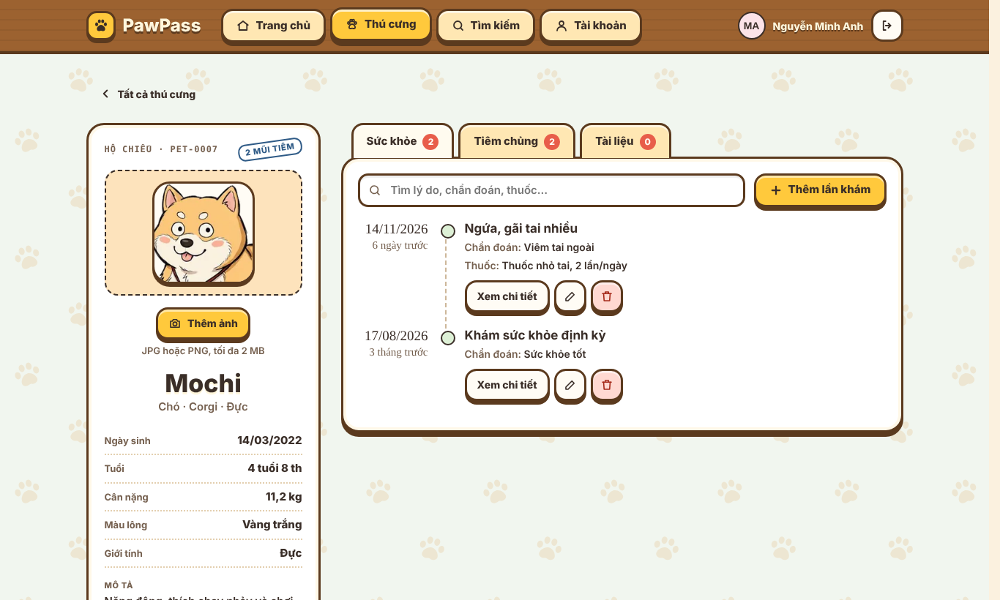
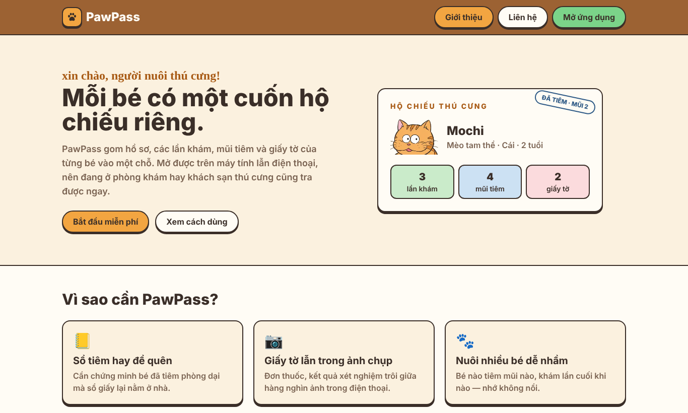
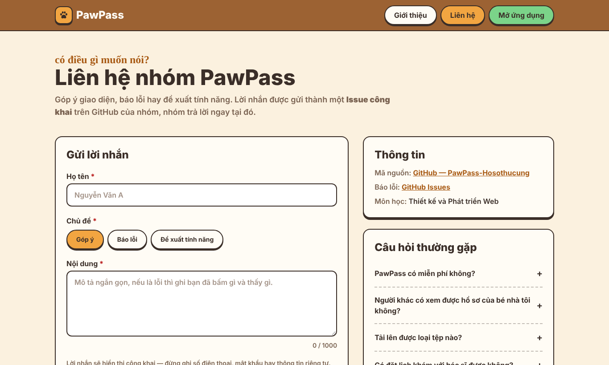
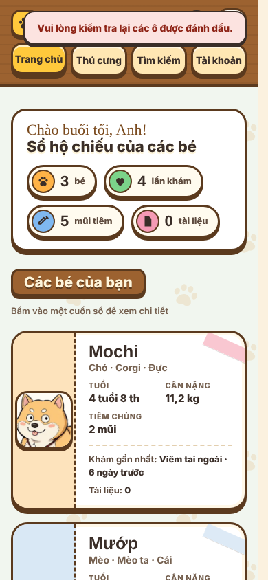
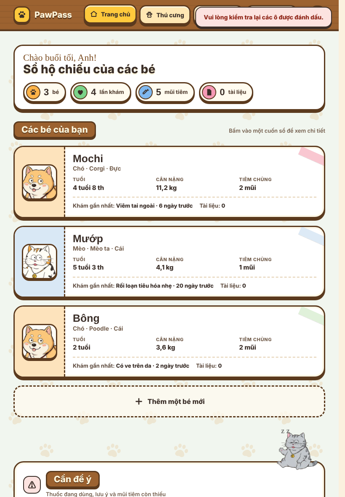
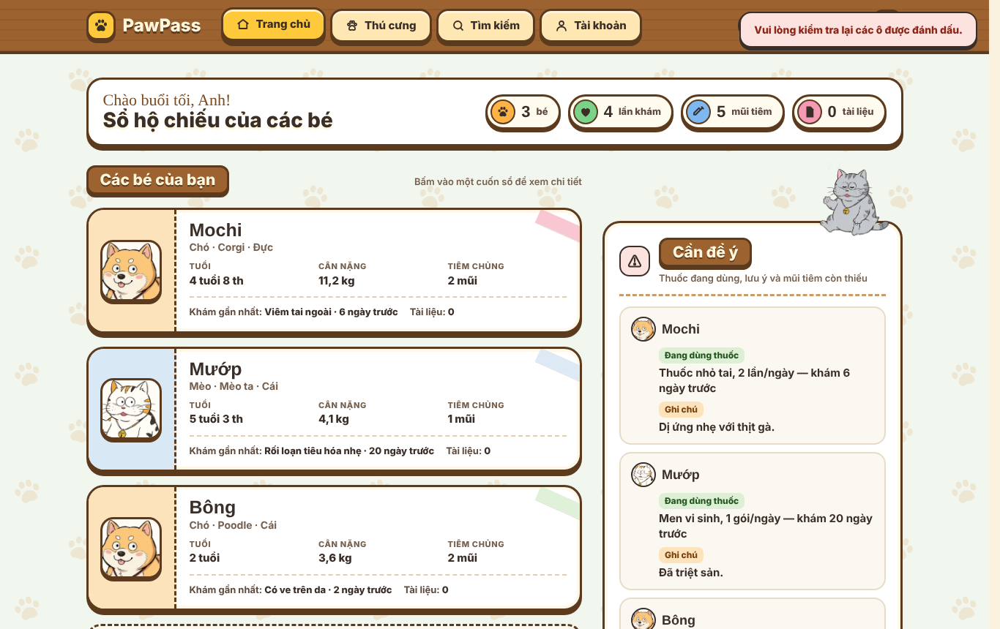
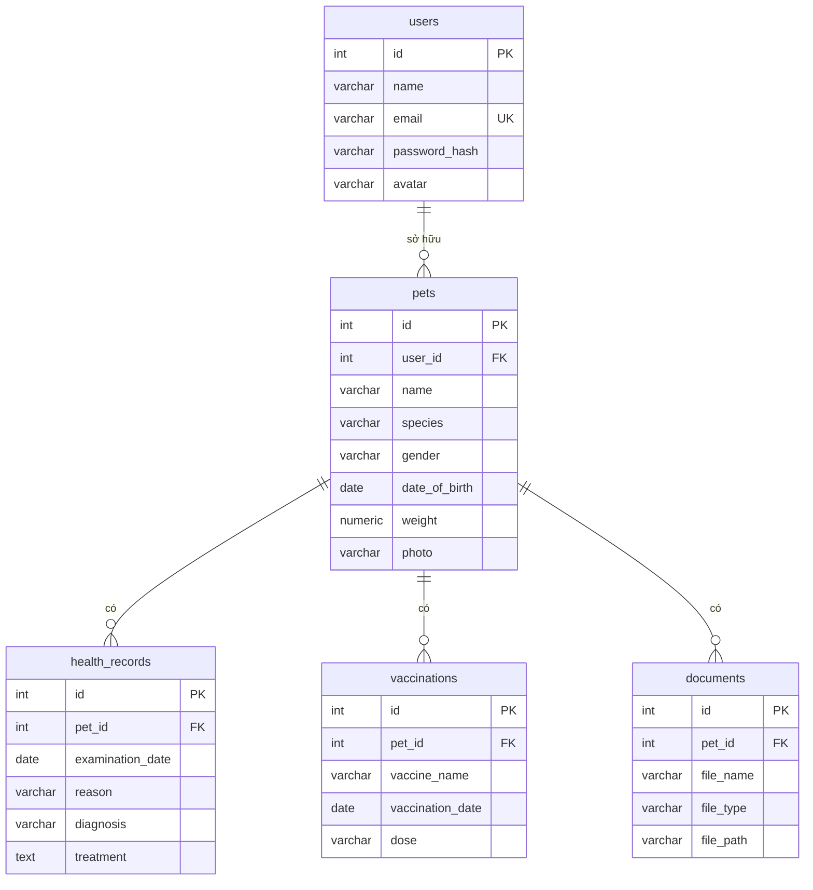
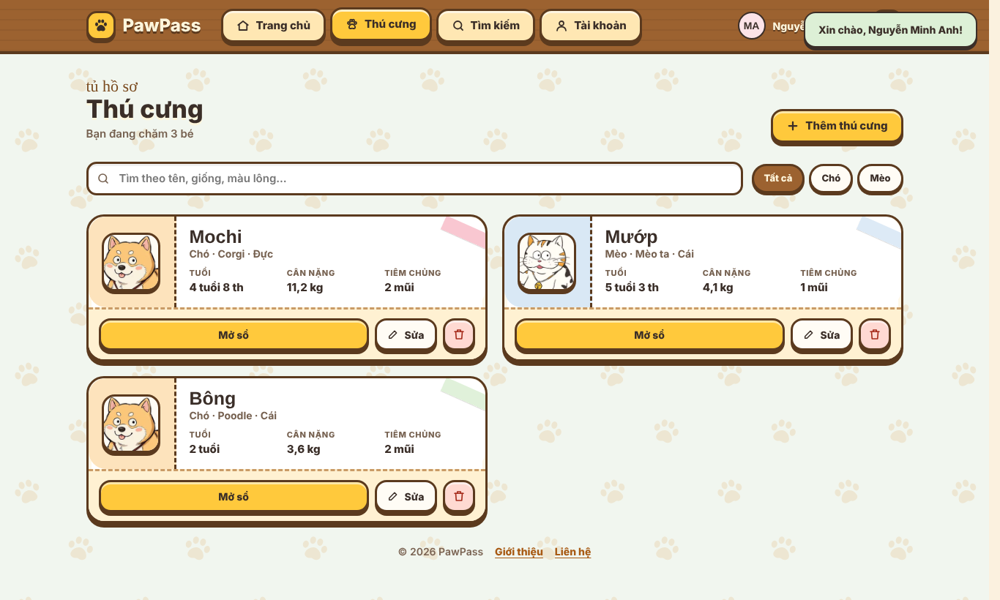

# Final Project Report — Web Design and Development

**PawPass — Sổ hộ chiếu thú cưng**

> Báo cáo nhóm theo [template của môn học](https://basic.web-programming.io.vn/final-project-report-template/).
> Tài liệu kỹ thuật chi tiết (cấu trúc thư mục, biến môi trường, deploy, xử lý lỗi, bảo mật): [`docs/KY-THUAT.md`](docs/KY-THUAT.md).

---

## Thông Tin Nhóm

| | |
|---|---|
| **Tên nhóm** | *(tên nhóm)* |
| **Tên dự án** | PawPass — Sổ hộ chiếu thú cưng |
| **GitHub Repository** | https://github.com/iceruychi-netizen/PawPass-Hosothucung |
| **Web đang chạy** | https://pawpass-hosothucung-web.vercel.app/ |
| **Video Demo** | *(link YouTube)* |
| **Ngày nộp** | *(DD/MM/YYYY)* |

### Thành viên nhóm

| Họ tên | MSSV | Vai trò |
|---|---|---|
| Nguyễn Hữu Triết | 24090003 | **Leader** — điều phối, làm việc với AI Coding Agent, deploy Vercel; Frontend: các màn hình, hình ảnh, trang Giới thiệu / Liên hệ |
| Đinh Phùng Duy Huy | 24090016 | Frontend — CSS, Tailwind CSS, cấu hình deploy, test giao diện |
| Nguyễn Thế Dũng | 24090007 | Frontend — logic JavaScript, gọi API, Google Analytics & Sentry phía trình duyệt |
| Nguyễn Phước Thành Đạt | 24090026 | Backend — API, bảo mật, lưu tệp, Sentry phía máy chủ |
| Đào Duy Quang | 24090005 | Backend — database, quy tắc kiểm tra dữ liệu, test API |

---

## Tổng Quan Project và Công Nghệ Sử Dụng

### Mô tả ứng dụng

PawPass là ứng dụng web giúp chủ nuôi lưu **hồ sơ, các lần khám, mũi tiêm và giấy tờ** của từng bé thú cưng ở một nơi, mở được trên cả máy tính lẫn điện thoại. Người dùng mục tiêu là chủ nuôi cá nhân có một hoặc nhiều bé, cần tra cứu nhanh khi đi khám, gửi khách sạn thú cưng hay đi tiêm. Mỗi người chỉ xem và sửa được dữ liệu của chính mình.

### Tech Stack

| Thành phần | Công nghệ |
|---|---|
| **Frontend** | HTML, CSS (prototype Step 1), **Tailwind CSS** (trang Giới thiệu / Liên hệ), JavaScript thuần — ứng dụng một trang (SPA) điều hướng bằng `#/...` |
| **Backend** | Node.js 20 (module `http`, không framework), RESTful API, chạy dưới dạng Vercel Function |
| **Database** | PostgreSQL (Neon), thư viện `pg` |
| **Lưu tệp** | Vercel Blob (ảnh thú cưng, giấy tờ) |
| **Theo dõi** | Google Analytics 4, Sentry |
| **Deploy** | Vercel |
| **Kiểm thử** | `node:test` (unit + integration), Playwright (E2E) |

### Tính năng chính

- Đăng ký, đăng nhập, đăng xuất; sửa tài khoản, ảnh đại diện, đổi mật khẩu
- Quản lý nhiều thú cưng: thêm, sửa, xóa (xóa kèm toàn bộ hồ sơ), đổi ảnh nhanh, lọc theo loài
- Hồ sơ sức khỏe từng lần khám, hiển thị dạng dòng thời gian
- Tiêm phòng, mỗi mũi hiển thị như một con dấu trong hộ chiếu
- Tải lên, xem trước, tải về giấy tờ JPG / PNG / PDF (tối đa 4 MB, kiểm tra cả nội dung tệp)
- Tìm kiếm toàn bộ dữ liệu, lọc theo loại kết quả
- Trang chủ tổng quan: thẻ hộ chiếu từng bé, số liệu tổng, mục "Cần để ý", "Gần đây"
- Trang Giới thiệu và trang Liên hệ (form gửi góp ý, câu hỏi thường gặp)
- Giao diện responsive cho điện thoại, máy tính bảng, máy tính

| Trang chủ | Chi tiết thú cưng — Sức khỏe |
|---|---|
|  |  |
| **Tiêm phòng** | **Tìm kiếm** |
|  |  |

---

## Hướng Dẫn Cài Đặt và Chạy Ứng Dụng

### Yêu cầu hệ thống

| Công cụ | Phiên bản |
|---|---|
| Node.js | >= 20.x |
| PostgreSQL | >= 14 (hoặc một database Neon miễn phí) |

### Các bước cài đặt

```bash
# 1. Clone repository
git clone https://github.com/iceruychi-netizen/PawPass-Hosothucung.git
cd PawPass-Hosothucung

# 2. Cài dependencies
npm install

# 3. Cấu hình môi trường
cp .env.example .env
# Sửa .env: DATABASE_URL và JWT_SECRET (tối thiểu 32 ký tự).
# GA_MEASUREMENT_ID và SENTRY_DSN không bắt buộc.

# 4. Khởi tạo database (API cũng tự tạo bảng ở lần chạy đầu)
createdb pawpass
npm run db:migrate
npm run db:seed          # tạo tài khoản demo: demo@pawpass.vn / 123456

# 5. Chạy ứng dụng
npm run build:css        # chỉ cần khi sửa class Tailwind
npm run dev              # http://localhost:3000 — cùng lúc giao diện và API
```

**Lưu ý:**
- Chạy trên máy cá nhân, ảnh và giấy tờ được lưu vào thư mục `uploads/`. Trên Vercel thì lưu vào Vercel Blob.
- Deploy lên Vercel (gắn Neon, Blob, đặt `JWT_SECRET`, chọn vùng máy chủ) và bảng xử lý lỗi thường gặp: xem [`docs/KY-THUAT.md`](docs/KY-THUAT.md#deploy-lên-vercel).
- Chạy test: `npm run test:unit` (không cần database) · `TEST_DATABASE_URL=postgres://... npm test` · `npm run test:ui`.

---

## Task 1 — Project Planning & Teamwork

### (a) Phân công vai trò

Nhóm chia dự án thành 5 phần theo lớp của ứng dụng, mỗi người phụ trách một phần: hiểu rõ, trình bày được và review mọi thay đổi chạm vào phần đó. Chi tiết từng file và việc cần làm: [`PHAN-CONG.md`](PHAN-CONG.md).

| Phần | Thành viên | Trách nhiệm | File chính |
|---|---|---|---|
| 1 | Hữu Triết (Leader) | Điều phối nhóm, làm việc với AI, deploy; các màn hình, hình ảnh, trang Giới thiệu / Liên hệ | `public/index.html`, `public/assets/`, `public/gioi-thieu.html`, `public/lien-he.html` |
| 2 | Duy Huy | CSS, Tailwind, cấu hình deploy, test giao diện, Lighthouse | `public/css/app.css`, `tailwind.config.js`, `src/tailwind.css`, `vercel.json`, `package.json`, `tests/ui/run-ui.js` |
| 3 | Thế Dũng | Logic frontend, gọi API, tương tác JavaScript, Google Analytics / Sentry trình duyệt | `public/js/app.js`, `public/js/runtime.js`, `public/js/site.js`, `public/js/monitoring.js` |
| 4 | Thành Đạt | API, xác thực, phân quyền, lưu tệp, Sentry máy chủ, báo cáo | `server/app.js`, `server/http.js`, `server/security.js`, `server/storage.js`, `server/monitor.js`, `README.md`, `CLAUDE.md` |
| 5 | Duy Quang | Database, quy tắc kiểm tra dữ liệu, test API | `db/schema.sql`, `server/schema.js`, `server/db.js`, `scripts/`, `public/js/validators.js`, `tests/` |

### (b) Wireframe

- **Công cụ sử dụng:** Claude Design (prototype có thể bấm thử — Step 1 của quy trình nhóm)
- **Các trang đã thiết kế:**
  - [x] Homepage (trang chủ tổng quan)
  - [x] Đăng nhập / Đăng ký
  - [x] Danh sách thú cưng, chi tiết thú cưng (3 tab Sức khỏe / Tiêm phòng / Tài liệu)
  - [x] Tìm kiếm, Tài khoản
  - [ ] Giới thiệu / Liên hệ (thêm sau, dựa trên phong cách của prototype)

*(Chèn ảnh xuất từ prototype vào `docs/images/wireframe-*.png` nếu có)*

### (c) Project Plan

Nhóm làm theo quy trình 3 bước: **Step 1 Prototype → Step 2 tài liệu đặc tả (PRD, kiến trúc, ERD, API) → Step 3 Planning → Review Plan → Code → Test**. Kế hoạch chi tiết theo phase, mỗi việc có người phụ trách và test chứng minh: [`PLAN.md`](PLAN.md).

| Milestone | Deadline | Trạng thái |
|---|---|---|
| Hoàn thành wireframe (prototype Step 1) | *(DD/MM)* | Hoàn thành *(Đúng hạn / Trễ X ngày)* |
| Setup GitHub & database schema (tài liệu Step 2: PRD, ERD, API) | *(DD/MM)* | Hoàn thành 12/11/2026 *(Đúng hạn / Trễ X ngày)* |
| Hoàn thành UI cơ bản | *(DD/MM)* | Hoàn thành 13/11/2026 *(Đúng hạn / Trễ X ngày)* |
| Tích hợp database xong (deploy Vercel + Neon + Blob) | *(DD/MM)* | Hoàn thành 13/11/2026 *(Đúng hạn / Trễ X ngày)* |
| Optimization & peer review | *(DD/MM)* | Tối ưu: hoàn thành · Peer review: *(trạng thái)* |
| Nộp bài | *(DD/MM)* | *(trạng thái)* |

### (d) GitHub Repository

- **Repository link:** https://github.com/iceruychi-netizen/PawPass-Hosothucung

### (e) GitHub workflow

**Quy ước commit** (áp dụng từ đợt bổ sung Tailwind / Giới thiệu / Liên hệ / Analytics):

```
<loại>: <việc đã làm, tiếng Việt, bắt đầu bằng động từ> (#<số issue>)

feat:  thêm trang Giới thiệu bằng Tailwind CSS (#2)
fix:   sửa màn hình chờ bị giật sau khi đăng nhập (#5)
docs:  viết báo cáo README theo template môn học (#6)
test:  thêm unit test cho module theo dõi lỗi Sentry (#4)
chore: cấu hình Tailwind và lệnh build:css (#1)
```

**Pull Request workflow:** mỗi việc là một **Issue** → mỗi người tạo **nhánh riêng** (`phan-<số>-<việc>`) → commit nhỏ theo quy ước trên → mở **Pull Request** ghi `Closes #<issue>` → người phụ trách phần bị sửa review (Vercel tạo link xem thử cho mỗi PR) → merge vào `main`. Chi tiết: [`PHAN-CONG.md`](PHAN-CONG.md#3-quy-trình-làm-việc).

**Ghi chú trung thực:** đợt code đầu tiên (13/11/2026) được đưa lên bằng "Add files via upload" trên giao diện web của GitHub, chưa theo quy ước trên. Các thay đổi sau đó đi qua Issue và Pull Request.

*(Chèn ảnh danh sách commit hoặc một Pull Request)*

---

## Task 2 — Implement User Interface

### (a) Các trang đã xây dựng

Ứng dụng chính là SPA trong `public/index.html` (điều hướng bằng `#/...`, xử lý trong `public/js/app.js`). Trang Giới thiệu và Liên hệ là hai trang HTML riêng.

| Trang | URL / Route | Mô tả | Người thực hiện |
|---|---|---|---|
| Homepage (Trang chủ) | `/#/dashboard` | Lời chào, số liệu tổng, thẻ hộ chiếu từng bé, "Cần để ý", "Gần đây" | Hữu Triết, Thế Dũng |
| Đăng nhập / Đăng ký | `/` | Form đăng nhập và đăng ký, có kiểm tra dữ liệu | Hữu Triết, Thế Dũng |
| Thú cưng | `/#/pets` | Danh sách các bé, tìm và lọc theo loài, thêm / sửa / xóa | Hữu Triết, Thế Dũng |
| Chi tiết thú cưng | `/#/pets/:id/health` · `/vaccinations` · `/documents` | Hộ chiếu của bé với 3 tab: sức khỏe, tiêm phòng, tài liệu | Hữu Triết, Thế Dũng |
| Tìm kiếm | `/#/search` | Tìm trên toàn bộ dữ liệu, lọc theo loại | Hữu Triết, Thế Dũng |
| Tài khoản | `/#/account` | Sửa thông tin, ảnh đại diện, đổi mật khẩu, đăng xuất | Hữu Triết, Thế Dũng |
| **About** (Giới thiệu) | `/gioi-thieu.html` | Vấn đề, tính năng, cách dùng, nhóm thực hiện | Hữu Triết, Duy Huy |
| **Contact** (Liên hệ) | `/lien-he.html` | Form góp ý / báo lỗi, thông tin nhóm, câu hỏi thường gặp | Hữu Triết, Thế Dũng |

| Đăng nhập | Giới thiệu | Liên hệ |
|---|---|---|
|  |  |  |

### (b) Sử dụng Tailwind CSS

- **Cài đặt:** `tailwindcss` trong `devDependencies` của `package.json`; cấu hình ở [`tailwind.config.js`](tailwind.config.js); nguồn ở [`src/tailwind.css`](src/tailwind.css); lệnh `npm run build:css` sinh ra `public/css/tailwind.css` (đã nén). Vercel tự chạy lệnh này khi deploy (`buildCommand` trong `vercel.json`).
- **Phạm vi:** Tailwind dùng cho trang Giới thiệu và Liên hệ. Ứng dụng chính giữ CSS viết tay trong `public/css/app.css` vì đã làm xong từ prototype Step 1; `content` của Tailwind chỉ quét các trang mới để hai bộ CSS không đè nhau.
- **Màu và phông riêng:** khai báo trong `theme.extend` cho giống ứng dụng chính: `bg-cream`, `bg-paper`, `text-ink`, `bg-orange`, `bg-mint`, `bg-sky`, `bg-rose`, phông `font-display` (Baloo 2), `font-body` (Nunito), `font-hand` (Patrick Hand), bóng `shadow-chunky`.
- **Component tự định nghĩa** bằng `@layer components` + `@apply`: `.pp-card`, `.pp-btn`, `.pp-input`.
- **Ví dụ utility classes đã dùng:**
  - Lưới responsive: `grid gap-5 sm:grid-cols-2 lg:grid-cols-4`, `md:grid-cols-2`, `lg:grid-cols-5` + `lg:col-span-3`
  - Menu điện thoại: `hidden md:flex`, `md:hidden`, `absolute top-full md:static`
  - Trạng thái form: `focus:ring-4 focus:ring-orange/40`, `peer-checked:bg-orange` (nút chọn chủ đề), báo lỗi bằng `border-red-700` / `text-red-700`
  - Khác: `sticky top-0`, `max-w-6xl mx-auto`, `rotate-12`, `divide-y-2 divide-dashed`

### (c) Các tính năng tương tác

| Tính năng | Mô tả | File / Component | Người thực hiện |
|---|---|---|---|
| Modal thêm / sửa | Form thêm và sửa thú cưng, lần khám, mũi tiêm, tài liệu, tài khoản trong hộp thoại | `public/js/app.js` (`openModal`, `submitModal`) | Thế Dũng |
| Form validation | Kiểm tra ngay trên trình duyệt (email, mật khẩu, cân nặng, ngày không ở tương lai, loại và dung lượng tệp); cùng bộ quy tắc với máy chủ | `public/js/validators.js`, `public/js/app.js` | Duy Quang, Thế Dũng |
| Form liên hệ | Báo lỗi ngay dưới ô, đếm ký tự, gửi thành Issue trên GitHub | `public/js/site.js` | Thế Dũng |
| Accordion câu hỏi thường gặp | Bấm để mở / đóng câu trả lời, hỗ trợ bàn phím (`aria-expanded`) | `public/js/site.js` | Thế Dũng |
| Menu điện thoại | Nút ☰ mở / đóng menu, phím Esc để đóng | `public/js/site.js` | Thế Dũng |
| Tìm kiếm & lọc | Gõ là lọc ngay, không tải lại trang | `public/js/app.js` | Thế Dũng |
| Tải ảnh & tài liệu | Thu nhỏ ảnh trước khi gửi, xem trước ảnh / PDF, tải về | `public/js/app.js` (`ppShrink`, `docUrl`) | Thế Dũng |
| Màn hình chờ & hoạt cảnh | Chó mèo chạy vào nhà cho đến khi dữ liệu tải xong; thú cưng đi dạo cuối trang, bấm vào thì nhảy | `public/index.html`, `public/css/app.css`, `public/js/app.js` | Hữu Triết, Duy Huy, Thế Dũng |

**Cách kiểm tra:** test E2E bằng Playwright ([`tests/ui/run-ui.js`](tests/ui/run-ui.js)) tự bấm qua toàn bộ luồng: đăng ký, thêm thú cưng, nhập sai form, tải tệp, tìm kiếm, người khác mở link bị chặn, xóa, đăng xuất.


### (d) Giao diện trên nhiều thiết bị

- [x] Mobile (< 768px) — kiểm tra ở 390px
- [x] Tablet (768px – 1024px) — kiểm tra ở 820px
- [x] Desktop (> 1024px) — kiểm tra ở 1366px

Test E2E kiểm tra **không có cuộn ngang** trên mọi trang ở cả 3 khổ. Ô nhập trên điện thoại dùng chữ 16px để iPhone không tự phóng to.

| Mobile (390px) | Tablet (820px) | Desktop (1366px) |
|---|---|---|
|  |  |  |

---

## Task 3 — Database Integration & Dynamic Content

### (a) Thiết kế cơ sở dữ liệu

- **Hệ quản trị CSDL:** PostgreSQL (Neon)
- **Số bảng:** 5 — định nghĩa ở [`db/schema.sql`](db/schema.sql)

| Bảng | Mô tả | Các cột chính |
|---|---|---|
| `users` | Tài khoản người dùng | `id`, `name`, `email` (duy nhất), `password_hash`, `avatar` |
| `pets` | Thú cưng, mỗi bé thuộc một người | `id`, `user_id` → users, `name`, `species`, `gender`, `date_of_birth`, `weight`, `photo` |
| `health_records` | Các lần khám | `id`, `pet_id` → pets, `examination_date`, `reason`, `diagnosis`, `treatment`, `medication` |
| `vaccinations` | Các mũi tiêm | `id`, `pet_id` → pets, `vaccine_name`, `vaccination_date`, `dose` |
| `documents` | Giấy tờ đã tải lên | `id`, `pet_id` → pets, `file_name`, `file_type` (jpg/png/pdf), `file_path`, `description` |

Mọi khóa ngoại đều `ON DELETE CASCADE`: xóa một bé là xóa luôn hồ sơ, mũi tiêm, tài liệu của bé. Có ràng buộc `CHECK` cho loài, giới tính, cân nặng (0 < kg ≤ 200) và loại tệp.



### (b) Kết nối cơ sở dữ liệu

- **Server-side:** Node.js 20 (module `http`, không dùng framework), triển khai thành Vercel Function ([`api/index.js`](api/index.js) → [`server/app.js`](server/app.js))
- **Cách kết nối:** RESTful API (JSON) — trình duyệt gọi `/api/...`, máy chủ truy vấn PostgreSQL qua thư viện `pg` với câu lệnh có tham số (`$1, $2`) để chống SQL injection ([`server/db.js`](server/db.js))
- **CRUD đã thực hiện:**
  - [x] Create — `POST /api/pets`, `/api/pets/:id/health-records`, `/vaccinations`, `/documents`, `/api/auth/register`
  - [x] Read — `GET /api/overview`, `/api/pets`, `/api/pets/:id`, các danh sách con, `/api/documents/:id/download`
  - [x] Update — `PUT /api/pets/:id`, `/api/health-records/:id`, `/api/vaccinations/:id`, `/api/auth/me`
  - [x] Delete — `DELETE /api/pets/:id`, `/api/health-records/:id`, `/api/vaccinations/:id`, `/api/documents/:id`

**Kiến trúc:**

```
Trình duyệt (HTML/CSS/JS)  ──HTTPS, JSON, token đăng nhập──▶  Vercel Function (Node.js, server/app.js)
                                                                 │  kiểm tra token + quyền sở hữu ở MỌI request
                                                                 ├──▶ PostgreSQL (Neon): 5 bảng
                                                                 └──▶ Vercel Blob: ảnh và giấy tờ
```

Mật khẩu băm bằng scrypt; token đăng nhập ký bằng HS256 (hết hạn 7 ngày); người khác mở dữ liệu không phải của mình nhận lỗi 403. Toàn bộ 27 endpoint: [`docs/KY-THUAT.md`](docs/KY-THUAT.md).

### (c) Các trang hiển thị dữ liệu động

| Trang | Dữ liệu hiển thị | Query / Endpoint | Người thực hiện |
|---|---|---|---|
| Trang chủ | Số bé, lần khám, mũi tiêm, tài liệu; thẻ từng bé; "Cần để ý"; "Gần đây" | `GET /api/overview` (4 truy vấn song song, lọc theo `pets.user_id`) | Thành Đạt, Thế Dũng |
| Thú cưng | Danh sách bé của người dùng | `GET /api/pets` → `SELECT * FROM pets WHERE user_id = $1` | Thành Đạt, Thế Dũng |
| Chi tiết — Sức khỏe | Dòng thời gian các lần khám | `GET /api/pets/:id/health-records` | Thành Đạt, Thế Dũng |
| Chi tiết — Tiêm phòng | Các mũi tiêm dạng con dấu | `GET /api/pets/:id/vaccinations` | Thành Đạt, Thế Dũng |
| Chi tiết — Tài liệu | Danh sách giấy tờ, ảnh xem trước | `GET /api/pets/:id/documents`, `GET /api/documents/:id/download` | Thành Đạt, Thế Dũng |
| Tìm kiếm | Kết quả trên toàn bộ dữ liệu | Dữ liệu từ `GET /api/overview`, lọc trên trình duyệt | Thế Dũng |
| Tài khoản | Tên, email, ảnh đại diện | `GET /api/auth/me` | Thành Đạt, Thế Dũng |

| Trang chủ | Thú cưng | Tài khoản |
|---|---|---|
|  |  |  |

---

## Task 4 — Optimization

### (a) Lighthouse

**Kết quả trước khi tối ưu** *(điền từ ảnh chụp lần chạy đầu)*

| Metric | Score |
|---|---|
| Performance | *(điểm)* |
| Accessibility | 98 |
| Best Practices | *(điểm)* |
| SEO | *(điểm)* |

*(Chèn ảnh Lighthouse trước khi tối ưu: `docs/images/lighthouse-truoc.png`)*

**Các vấn đề phát hiện và cách khắc phục:**

| Vấn đề | Hành động khắc phục |
|---|---|
| Ảnh minh họa nặng (PNG, tổng 1.040 KB) | Chuyển sang WebP, thu nhỏ đúng kích thước hiển thị → 196 KB |
| Thiếu điểm mốc `<main>` cho trình đọc màn hình | Bọc nội dung bằng `<main id="app">` |
| Phông chữ Google chặn hiển thị | Tải bằng `rel="preload"` rồi đổi thành stylesheet khi tải xong |
| Script chặn hiển thị | Thêm `defer` cho mọi script |
| `app.css` chặn hiển thị ("Yêu cầu chặn hiển thị") | Tải song song, giữ màu nền trong lúc chờ, hiện giao diện khi CSS về |
| Màn hình giật (hoạt cảnh dùng `left`, 182 lần tính bố cục / 3 giây) | Đổi sang `transform` → còn 2 lần |
| Trang chủ gọi máy chủ 1 + 3×số bé lần | Thêm `GET /api/overview`: 1 lần gọi |
| Ảnh tải lên lớn (ảnh điện thoại 2 MB) | Thu nhỏ còn tối đa 800px trước khi gửi (~230 KB) |
| Google Analytics và Sentry làm chậm lúc mở trang | Chỉ tải sau khi trang hiện xong và trình duyệt rảnh |

**Kết quả sau khi tối ưu** *(desktop)*

| Metric | Score |
|---|---|
| Performance | 100 |
| Accessibility | 100 |
| Best Practices | 100 |
| SEO | 100 |

*(Chèn ảnh Lighthouse sau khi tối ưu: `docs/images/lighthouse-sau.png`. Mobile: Performance 99)*

### (b) Theo dõi lỗi và hành vi người dùng

Cả hai đều bật bằng **biến môi trường trên Vercel** (Settings → Environment Variables), không ghi cứng mã vào code. Trình duyệt lấy cấu hình qua `GET /api/config`.

#### Google Analytics

- [x] Đã tích hợp — [`public/js/monitoring.js`](public/js/monitoring.js)
- **Measurement ID:** *(G-XXXXXXXXXX — đặt vào biến `GA_MEASUREMENT_ID`)*
- **Cách tích hợp:** tải `gtag.js` sau khi trang hiện xong; vì ứng dụng là SPA nên tự gửi `page_view` mỗi khi đổi trang (số id trong đường dẫn được thay bằng `:id`, ví dụ `/#/pets/:id/health`). Sự kiện riêng: `login`, `sign_up`, `create_pet`, `create_health`, `create_vacc`, `create_doc`, `update_*`, `form_invalid`, `contact_submit`, `faq_open`. Không gửi tên, email hay nội dung hồ sơ.

*(Chèn ảnh dashboard Google Analytics)*

#### Sentry

- [x] Đã tích hợp
- **Công cụ:** Sentry
- **DSN / Config:** biến `SENTRY_DSN` trên Vercel *(ghi tên project Sentry)*
- **Các loại lỗi được theo dõi:**
  - **Trình duyệt** ([`public/js/monitoring.js`](public/js/monitoring.js)): lỗi JavaScript và Promise bị từ chối, kể cả lỗi xảy ra trước khi Sentry kịp tải
  - **Máy chủ** ([`server/monitor.js`](server/monitor.js)): mọi lỗi 5xx của API (mất kết nối database, lỗi lưu tệp lên Blob, lỗi không lường trước), kèm phương thức, đường dẫn đã ẩn id và stack trace. Lỗi do người dùng nhập sai (4xx) không gửi. Có unit test với máy chủ Sentry giả ([`tests/unit/monitor.test.js`](tests/unit/monitor.test.js))

*(Chèn ảnh dashboard Sentry hoặc error log)*

---

## Task 5 — UI/UX Peer Review & Evaluation

### (a) Feedback cho các nhóm khác

#### Nhóm được review #1

- **Tên nhóm / dự án:** *(…)*
- **Link project:** *(…)*

| Khía cạnh | Điểm mạnh | Gợi ý cải thiện |
|---|---|---|
| Usability | | |
| Aesthetics | | |
| User-Friendliness | | |

#### Nhóm được review #2

- **Tên nhóm / dự án:** *(…)*
- **Link project:** *(…)*

| Khía cạnh | Điểm mạnh | Gợi ý cải thiện |
|---|---|---|
| Usability | | |
| Aesthetics | | |
| User-Friendliness | | |

### (b) Xử lý feedback nhận được

| Feedback | Nguồn (nhóm nào) | Quyết định | Lý do / Commit |
|---|---|---|---|
| | | Đã implement / Không implement | |

---

## Deliverables Checklist

- [x] Source code trên GitHub (repository public)
- [x] README.md đầy đủ: hướng dẫn cài đặt, tổng quan, tính năng kèm ảnh, ERD
- [ ] Video demo trên YouTube (tối đa 10 phút, tối thiểu 720p, không để riêng tư)
- [ ] Self-report: mỗi thành viên đã commit file vào `docs/self-reports/`

---

## Self-Reports

| Họ tên | MSSV | Link Self-Report |
|---|---|---|
| Nguyễn Hữu Triết | 24090003 | [self-report-24090003.md](docs/self-reports/self-report-24090003.md) |
| Đinh Phùng Duy Huy | 24090016 | [self-report-24090016.md](docs/self-reports/self-report-24090016.md) |
| Nguyễn Thế Dũng | 24090007 | [self-report-24090007.md](docs/self-reports/self-report-24090007.md) |
| Nguyễn Phước Thành Đạt | 24090026 | [self-report-24090026.md](docs/self-reports/self-report-24090026.md) |
| Đào Duy Quang | 24090005 | [self-report-24090005.md](docs/self-reports/self-report-24090005.md) |

---

## Khai báo sử dụng AI

Nhóm dùng **Claude (Anthropic)** làm AI Coding Agent theo quy trình Step 3: AI nhận tài liệu Step 1–2 cùng quy tắc trong [`CLAUDE.md`](CLAUDE.md), lập kế hoạch ([`PLAN.md`](PLAN.md)), viết code và test; nhóm review, deploy, thử trên web thật và báo lỗi để sửa. Phần lớn mã nguồn được viết với sự hỗ trợ của AI. Mỗi thành viên khai báo cụ thể phần mình dùng AI trong self-report và chịu trách nhiệm giải thích được phần mình phụ trách.
