# Final Project Report — Web Design and Development

**PawPass — Sổ hộ chiếu thú cưng**

> Báo cáo nhóm theo [template của môn học](https://basic.web-programming.io.vn/final-project-report-template/).
> Tài liệu kỹ thuật chi tiết (cấu trúc thư mục, biến môi trường, deploy, xử lý lỗi, bảo mật): [`docs/KY-THUAT.md`](docs/KY-THUAT.md).

---

## Thông Tin Nhóm

| | |
|---|---|
| **Tên nhóm** | PawPass |
| **Tên dự án** | PawPass — Sổ hộ chiếu thú cưng |
| **GitHub Repository** | https://github.com/iceruychi-netizen/PawPass-Hosothucung |
| **Web đang chạy** | https://pawpass-hosothucung-web.vercel.app/ |
| **Video Demo** | https://www.youtube.com/watch?v=W2zrzrErFAk |
| **Ngày nộp** | 21/11/2026 |

### Thành viên nhóm

| Họ tên | MSSV | Vai trò |
|---|---|---|
| Nguyễn Hữu Triết | 24090003 | **Leader** — điều phối, làm việc với AI Coding Agent, deploy Vercel, sửa lỗi sau deploy, đợt bổ sung 20/11; phần 1: các màn hình & hình ảnh |
| Đinh Phùng Duy Huy | 24090016 | Frontend — phần 2: CSS, cấu hình deploy, test giao diện |
| Nguyễn Thế Dũng | 24090007 | Frontend — phần 3: logic JavaScript, gọi API |
| Nguyễn Phước Thành Đạt | 24090026 | Backend — phần 4: API, bảo mật, lưu tệp |
| Đào Duy Quang | 24090005 | Backend — phần 5: database, quy tắc kiểm tra dữ liệu, test API |

---

## Tổng Quan Project và Công Nghệ Sử Dụng

### Mô tả ứng dụng

PawPass là ứng dụng web giúp chủ nuôi lưu **hồ sơ, các lần khám, mũi tiêm và giấy tờ** của từng bé thú cưng ở một nơi, mở được trên cả máy tính lẫn điện thoại. Người dùng mục tiêu là chủ nuôi cá nhân có một hoặc nhiều bé, cần tra cứu nhanh khi đi khám, gửi khách sạn thú cưng hay đi tiêm. Mỗi người chỉ xem và sửa được dữ liệu của chính mình.

### Tech Stack

| Thành phần | Công nghệ |
|---|---|
| **Frontend** | HTML, CSS (prototype Step 1), **Tailwind CSS** (trang Giới thiệu / Liên hệ), JavaScript thuần — ứng dụng một trang (SPA) điều hướng bằng `#/...` |
| **Backend** | Node.js 20 (module `http`, không framework), RESTful API, chạy dưới dạng Vercel Function |
| **Database** | PostgreSQL (Neon), thư viện `pg` |
| **Lưu tệp** | Vercel Blob (ảnh thú cưng, giấy tờ) |
| **Theo dõi** | Google Analytics 4, Sentry |
| **Deploy** | Vercel |
| **Kiểm thử** | `node:test` (unit + integration), Playwright (E2E) |

### Tính năng chính

- Đăng ký, đăng nhập, đăng xuất; sửa tài khoản, ảnh đại diện, đổi mật khẩu
- Quản lý nhiều thú cưng: thêm, sửa, xóa (xóa kèm toàn bộ hồ sơ), đổi ảnh nhanh, lọc theo loài
- Hồ sơ sức khỏe từng lần khám, hiển thị dạng dòng thời gian
- Tiêm phòng, mỗi mũi hiển thị như một con dấu trong hộ chiếu
- Tải lên, xem trước, tải về giấy tờ JPG / PNG / PDF (tối đa 4 MB, kiểm tra cả nội dung tệp)
- Tìm kiếm toàn bộ dữ liệu, lọc theo loại kết quả
- Trang chủ tổng quan: thẻ hộ chiếu từng bé, số liệu tổng, mục "Cần để ý", "Gần đây"
- Trang Giới thiệu và trang Liên hệ (form gửi góp ý, câu hỏi thường gặp)
- Giao diện responsive cho điện thoại, máy tính bảng, máy tính

| Trang chủ | Chi tiết thú cưng — Sức khỏe |
|---|---|
| 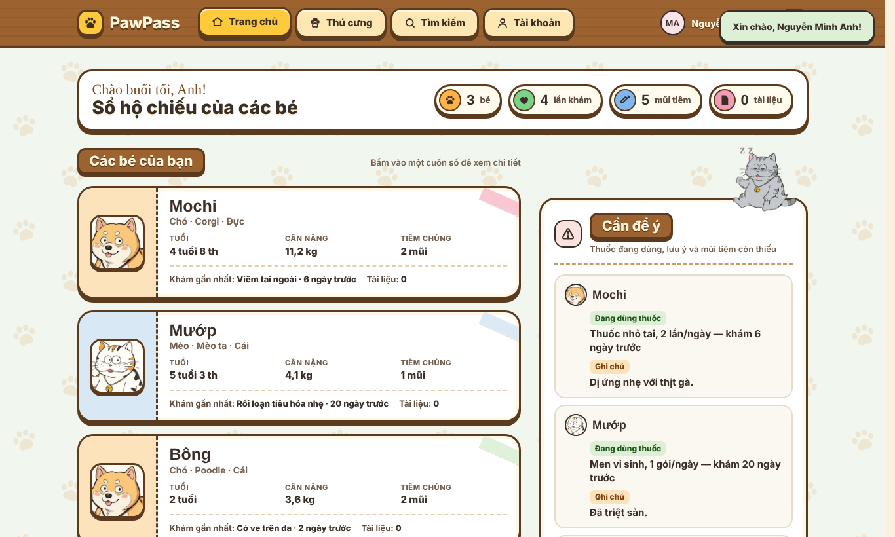 |  |
| **Tiêm phòng** | **Tìm kiếm** |
| 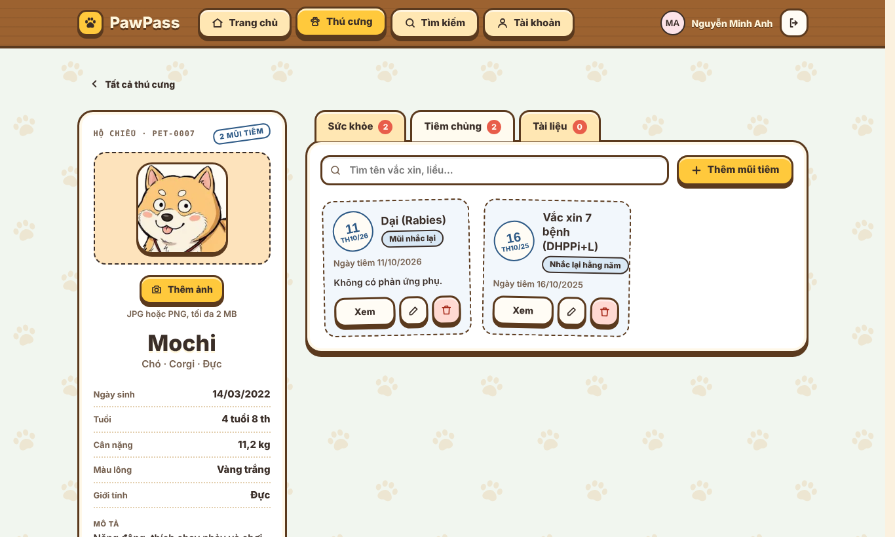 | 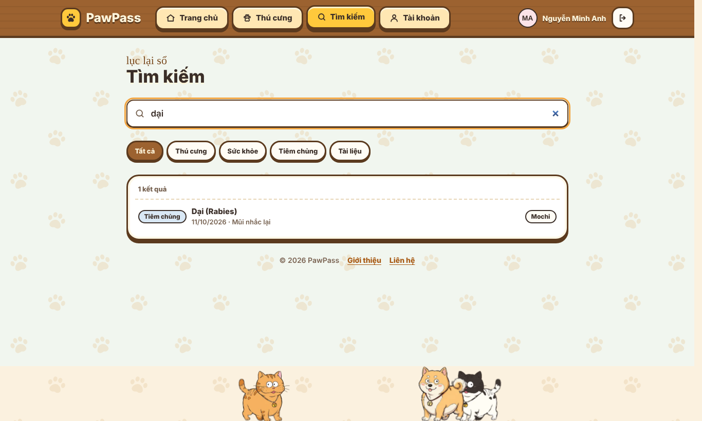 |

---

## Hướng Dẫn Cài Đặt và Chạy Ứng Dụng

### Yêu cầu hệ thống

| Công cụ | Phiên bản |
|---|---|
| Node.js | >= 20.x |
| PostgreSQL | >= 14 (hoặc một database Neon miễn phí) |

### Các bước cài đặt

```bash
# 1. Clone repository
git clone https://github.com/iceruychi-netizen/PawPass-Hosothucung.git
cd PawPass-Hosothucung

# 2. Cài dependencies
npm install

# 3. Cấu hình môi trường
cp .env.example .env
# Sửa .env: DATABASE_URL và JWT_SECRET (tối thiểu 32 ký tự).
# GA_MEASUREMENT_ID và SENTRY_DSN không bắt buộc.

# 4. Khởi tạo database (API cũng tự tạo bảng ở lần chạy đầu)
createdb pawpass
npm run db:migrate
npm run db:seed          # tạo tài khoản demo: demo@pawpass.vn / 123456

# 5. Chạy ứng dụng
npm run build:css        # chỉ cần khi sửa class Tailwind
npm run dev              # http://localhost:3000 — cùng lúc giao diện và API
```

**Lưu ý:**
- Chạy trên máy cá nhân, ảnh và giấy tờ được lưu vào thư mục `uploads/`. Trên Vercel thì lưu vào Vercel Blob.
- Deploy lên Vercel (gắn Neon, Blob, đặt `JWT_SECRET`, chọn vùng máy chủ) và bảng xử lý lỗi thường gặp: xem [`docs/KY-THUAT.md`](docs/KY-THUAT.md#deploy-lên-vercel).
- Chạy test: `npm run test:unit` (không cần database) · `TEST_DATABASE_URL=postgres://... npm test` · `npm run test:ui`.

---

## Task 1 — Project Planning & Teamwork

### (a) Phân công vai trò

Nhóm chia dự án thành 5 phần theo lớp của ứng dụng. Mỗi người phụ trách một phần: đưa phần đó lên repo, đọc hiểu và trình bày được. Mã nguồn được viết với AI Coding Agent (xem mục **Khai báo sử dụng AI** cuối báo cáo). Chi tiết: [`PHAN-CONG.md`](PHAN-CONG.md).

| Phần | Thành viên | Trách nhiệm | File chính | Commit đưa lên |
|---|---|---|---|---|
| 1 | Hữu Triết (Leader) | Điều phối nhóm, làm việc với AI, deploy và cấu hình Vercel / Neon / Blob, sửa lỗi sau deploy, đợt bổ sung 20/11; các màn hình & hình ảnh | `public/index.html`, `public/assets/` | [`a735c4d`](https://github.com/iceruychi-netizen/PawPass-Hosothucung/commit/a735c4d) |
| 2 | Duy Huy | CSS, cấu hình deploy, test giao diện | `public/css/app.css`, `vercel.json`, `package.json`, `.gitignore`, `.env.example`, `tests/ui/run-ui.js` | [`7cc1796`](https://github.com/iceruychi-netizen/PawPass-Hosothucung/commit/7cc1796), [`5d98e0f`](https://github.com/iceruychi-netizen/PawPass-Hosothucung/commit/5d98e0f); `app.css`, `run-ui.js` đưa vào đúng chỗ bởi Hữu Triết ([`9621df1`](https://github.com/iceruychi-netizen/PawPass-Hosothucung/commit/9621df1)) |
| 3 | Thế Dũng | Logic frontend, gọi API | `public/js/app.js`, `public/js/runtime.js` | [`e5c84fa`](https://github.com/iceruychi-netizen/PawPass-Hosothucung/commit/e5c84fa) |
| 4 | Thành Đạt | API, xác thực, phân quyền, lưu tệp | `server/app.js`, `server/http.js`, `server/security.js`, `server/storage.js`, `server/local.js`, `api/index.js` | [`14d7456`](https://github.com/iceruychi-netizen/PawPass-Hosothucung/commit/14d7456) |
| 5 | Duy Quang | Database, quy tắc kiểm tra dữ liệu, test API | `db/schema.sql`, `server/schema.js`, `server/db.js`, `server/env.js`, `scripts/`, `public/js/validators.js`, `tests/api.test.js` | [`d98340c`](https://github.com/iceruychi-netizen/PawPass-Hosothucung/commit/d98340c) |

Sau khi cả nhóm đưa code lên (13/11), các bản sửa lỗi khi chạy thật và đợt bổ sung theo đề bài (20/11: Tailwind CSS, trang Giới thiệu / Liên hệ, Google Analytics, Sentry, báo cáo này) do Hữu Triết thực hiện cùng AI và đưa lên.

### (b) Wireframe

- **Công cụ sử dụng:** Claude Design — prototype bấm thử được (Step 1 của quy trình nhóm), bắt đầu ngày **09/11/2026**, chốt bản cuối ngày **11/11/2026** sau nhiều vòng sửa
- **Các trang đã thiết kế:**
  - [x] Homepage (trang chủ tổng quan)
  - [x] Đăng nhập / Đăng ký
  - [x] Danh sách thú cưng, chi tiết thú cưng (3 tab Sức khỏe / Tiêm phòng / Tài liệu)
  - [x] Tìm kiếm, Tài khoản
  - [x] Giới thiệu, Liên hệ, Tìm kiếm, Tài khoản — wireframe bổ sung ngày 27/11/2026 (xem bên dưới)

| Bản đầu (09/11) — trang giới thiệu | Bản đầu (09/11) — trang chủ |
|---|---|
| 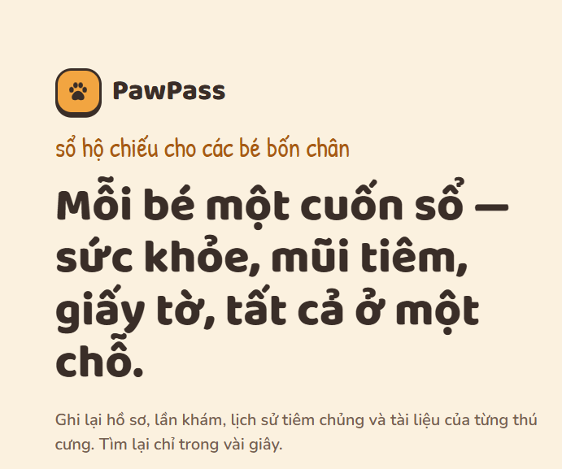 | 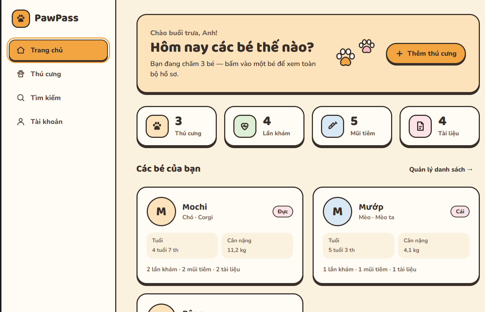 |
| **Bản chốt (11/11) — đăng nhập** | **Bản chốt (11/11) — trang chủ** |
| 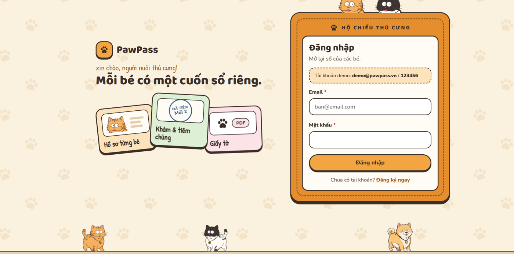 | 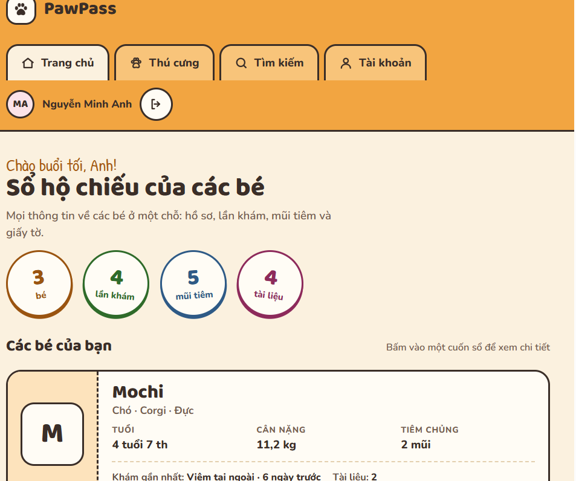 |
| **Bản chốt (11/11) — chọn thú cưng** | **Bản chốt (11/11) — hộ chiếu từng bé** |
| 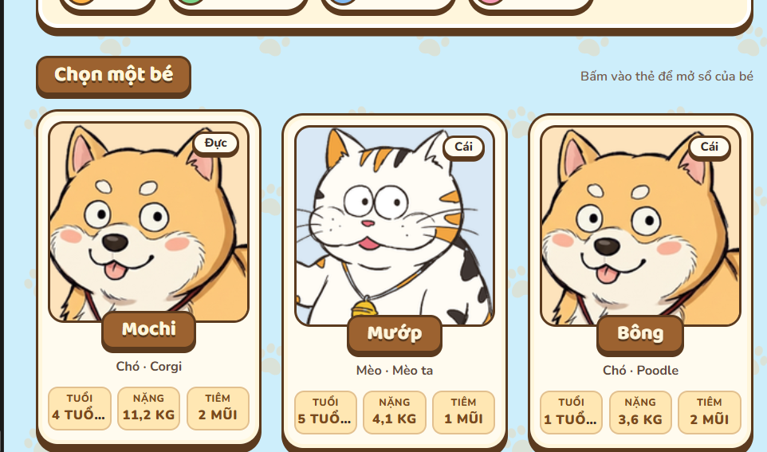 | 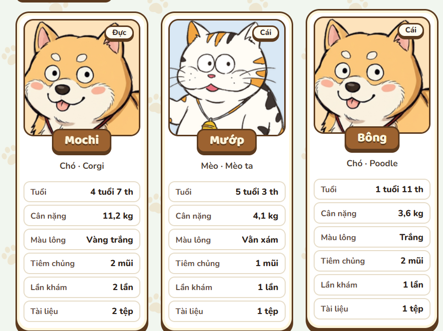 |

**Wireframe bổ sung (27/11/2026)** — bản chấm thử ghi nhận wireframe chưa phủ trang Giới thiệu, Liên hệ, Tìm kiếm, Tài khoản. Duy Huy vẽ thêm 4 trang, mỗi trang bản desktop và điện thoại (Issue [#7](https://github.com/iceruychi-netizen/PawPass-Hosothucung/issues/7), PR [#17](https://github.com/iceruychi-netizen/PawPass-Hosothucung/pull/17)); ảnh trong [`docs/images/wireframe/`](docs/images/wireframe/), file nguồn HTML trong [`docs/wireframe-src/`](docs/wireframe-src/). Cả nhóm duyệt trong buổi họp ngày 27/11 — [biên bản](docs/bien-ban/2026-11-27-hop-duyet-wireframe-va-csdl.md).

| Trang | Desktop | Điện thoại |
|---|---|---|
| Giới thiệu | 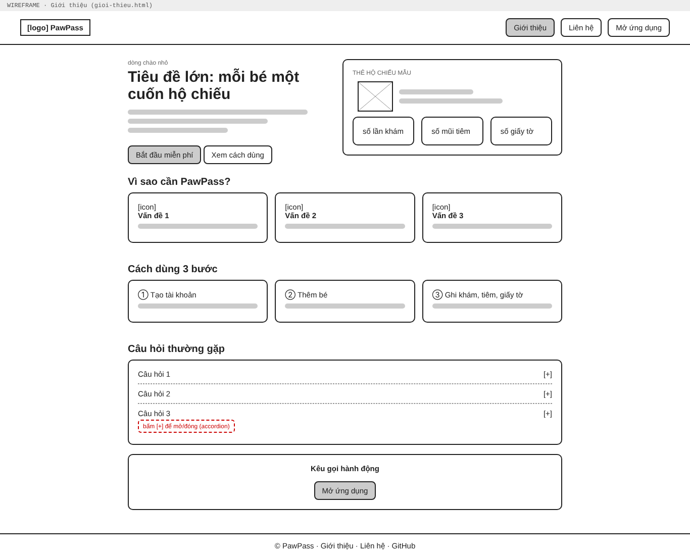 | 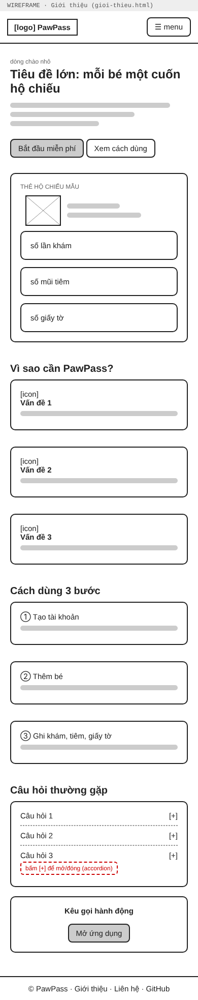 |
| Liên hệ | 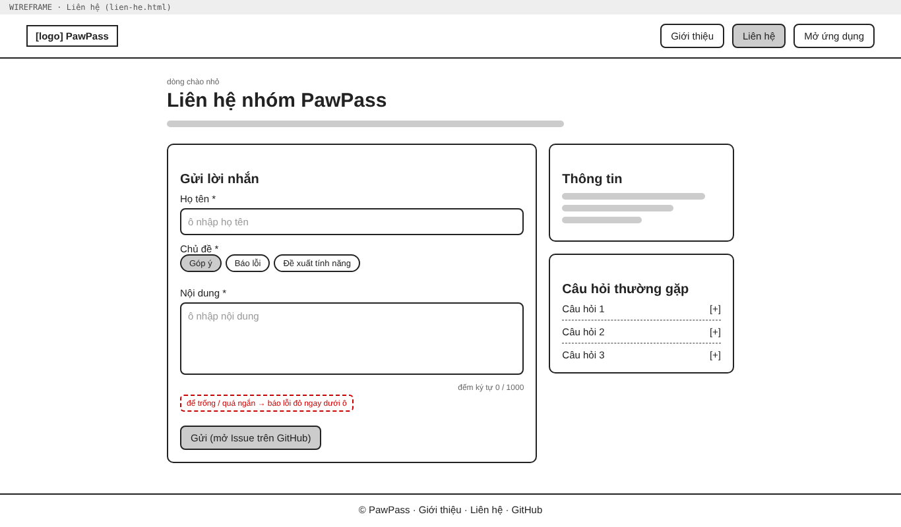 | 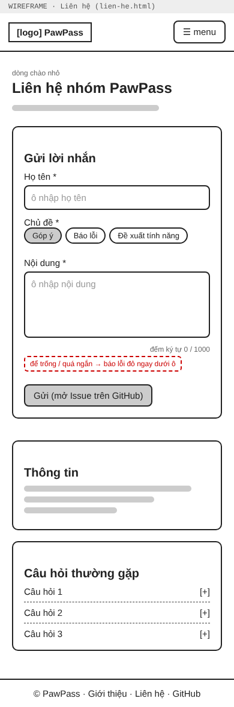 |
| Tìm kiếm | 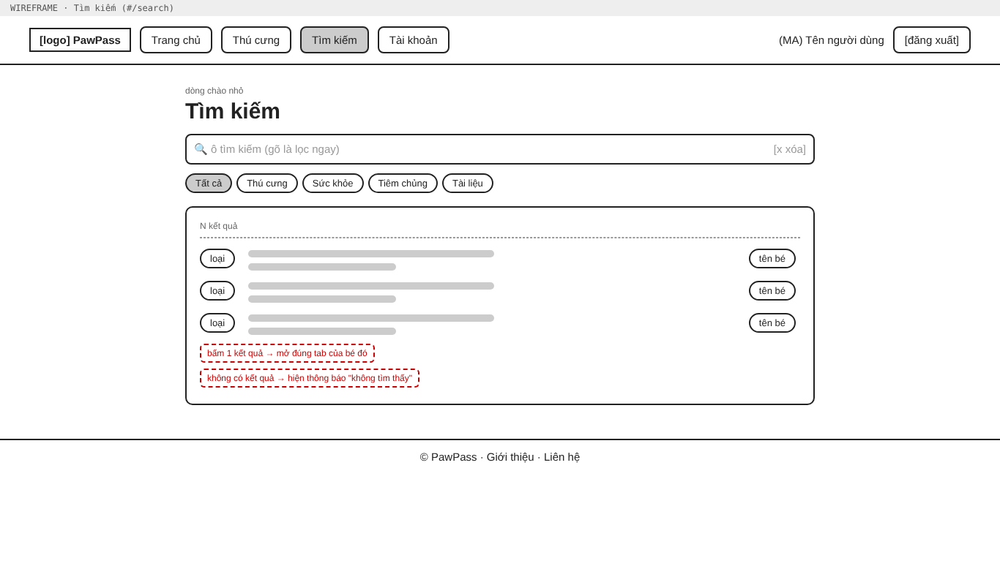 | 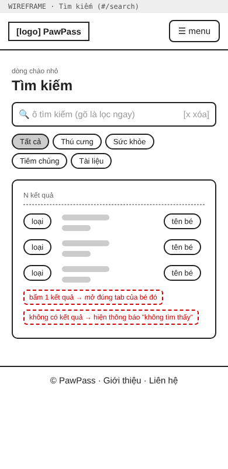 |
| Tài khoản | 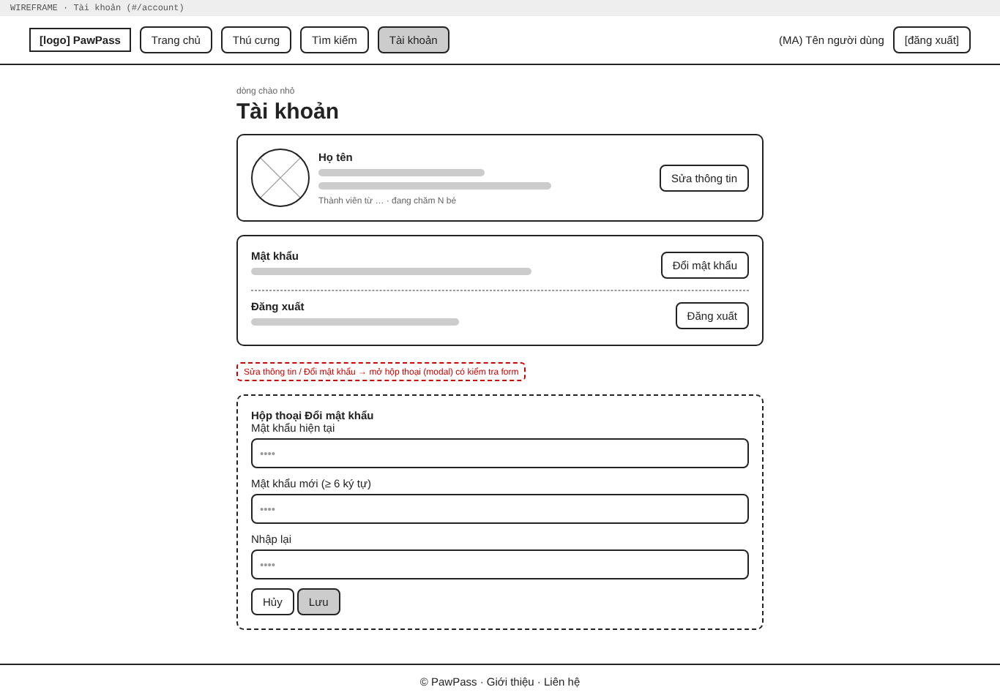 | 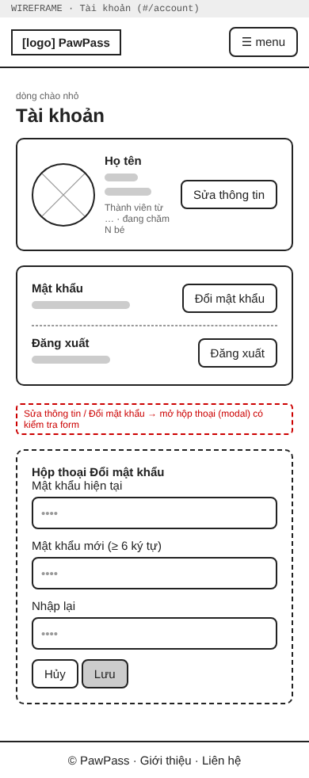 |

### (c) Project Plan

Nhóm làm theo quy trình 3 bước: **Step 1 Prototype → Step 2 tài liệu đặc tả (PRD, kiến trúc, ERD, API) → Step 3 Planning → Review Plan → Code → Test**. Kế hoạch chi tiết theo phase, mỗi việc có người phụ trách và test chứng minh: [`PLAN.md`](PLAN.md).

| Milestone | Deadline | Trạng thái |
|---|---|---|
| Hoàn thành wireframe (prototype Step 1) | 21/11/2026 | Đúng hạn — hoàn thành **11/11/2026** (bắt đầu 09/11) |
| Setup GitHub & database schema | 21/11/2026 | Đúng hạn — ERD và API Docs trong tài liệu Step 2: **12/11/2026** · Repo GitHub chung của nhóm: **13/11/2026** |
| Hoàn thành UI cơ bản | 21/11/2026 | Đúng hạn — hoàn thành **12/11/2026** (code Step 3, chạy được trên Vercel) |
| Tích hợp database xong | 21/11/2026 | Đúng hạn — hoàn thành **12/11/2026** (Vercel + Neon + Vercel Blob, đăng ký / lưu thú cưng / tải ảnh chạy được) |
| Optimization & peer review | 21/11/2026 | Đúng hạn — tối ưu: hoàn thành **13/11/2026** (Lighthouse, sửa giật, tăng tốc), bổ sung **20/11/2026** (Tailwind, Giới thiệu / Liên hệ, Google Analytics, Sentry) · Peer review: hoàn thành (review nhóm 2 và nhóm 5, xử lý 3 góp ý của nhóm 2) |
| Nộp bài | 21/11/2026 | Đúng hạn — báo cáo, self-report và video hoàn thành ngày 20/11/2026 |

Ngày hoàn thành lấy từ ngày tạo prototype, ảnh chụp màn hình khi deploy và lịch sử commit. Hạn nộp của môn là 21/11/2026, nhóm không có hạn riêng cho từng milestone nên cột Deadline dùng ngày nộp.

**Kế hoạch phần việc bổ sung sau bản chấm thử (25/11/2026)** — theo dõi bằng [GitHub Milestones](https://github.com/iceruychi-netizen/PawPass-Hosothucung/milestones), mỗi việc là một Issue có người phụ trách và hạn riêng:

| Milestone | Hạn | Issue | Người phụ trách | Trạng thái |
|---|---|---|---|---|
| [M1 · Sửa lỗi Lighthouse sau khi đăng nhập](https://github.com/iceruychi-netizen/PawPass-Hosothucung/milestone/1) | 26/11/2026 | [#1](https://github.com/iceruychi-netizen/PawPass-Hosothucung/issues/1), [#3](https://github.com/iceruychi-netizen/PawPass-Hosothucung/issues/3), [#5](https://github.com/iceruychi-netizen/PawPass-Hosothucung/issues/5) | Hữu Triết | Hoàn thành 26/11 |
| [M2 · Wireframe bổ sung và họp duyệt](https://github.com/iceruychi-netizen/PawPass-Hosothucung/milestone/2) | 27/11/2026 | [#7](https://github.com/iceruychi-netizen/PawPass-Hosothucung/issues/7), [#8](https://github.com/iceruychi-netizen/PawPass-Hosothucung/issues/8) | Duy Huy (wireframe), Thế Dũng (họp duyệt, biên bản) | Hoàn thành 27/11 |
| [M3 · Góp ý UI/UX chi tiết cho nhóm 2 và nhóm 5](https://github.com/iceruychi-netizen/PawPass-Hosothucung/milestone/3) | 28/11/2026 | [#9](https://github.com/iceruychi-netizen/PawPass-Hosothucung/issues/9), [#10](https://github.com/iceruychi-netizen/PawPass-Hosothucung/issues/10) | Thế Dũng (nhóm 2), Hữu Triết (nhóm 5) | Hoàn thành 27/11 |
| [M4 · Cập nhật README và nộp bài](https://github.com/iceruychi-netizen/PawPass-Hosothucung/milestone/4) | 29/11/2026 | [#11](https://github.com/iceruychi-netizen/PawPass-Hosothucung/issues/11) | Hữu Triết | README cập nhật 27/11 |

### (d) GitHub Repository

- **Repository link:** https://github.com/iceruychi-netizen/PawPass-Hosothucung

### (e) GitHub workflow

**Cách nhóm đã làm thực tế:**

- Nhóm làm trực tiếp trên nhánh `main`, **không tạo nhánh riêng, không dùng Issue và Pull Request**.
- Tối 13/11/2026, mỗi thành viên đưa phần của mình lên bằng **"Add files via upload"** trên giao diện web GitHub (19:49 – 19:58). Duy Huy upload nhầm cả thư mục zip lên nên đã xóa và upload lại phần cấu hình ([`9328c46`](https://github.com/iceruychi-netizen/PawPass-Hosothucung/commit/9328c46), [`5d98e0f`](https://github.com/iceruychi-netizen/PawPass-Hosothucung/commit/5d98e0f)); `app.css` và `run-ui.js` được Hữu Triết đưa vào đúng chỗ sau đó ([`9621df1`](https://github.com/iceruychi-netizen/PawPass-Hosothucung/commit/9621df1)).
- Sau đó Hữu Triết dùng GitHub Desktop để đưa lên các bản sửa lỗi khi chạy thật trên Vercel (13/11, 20:13 – 22:28). Có một lần xung đột khi gộp code, đã xử lý bằng commit gộp [`641a49f`](https://github.com/iceruychi-netizen/PawPass-Hosothucung/commit/641a49f).
- Đợt bổ sung theo đề bài được đưa lên ngày 20/11/2026.

**Commit tiêu biểu:**

| Commit | Nội dung |
|---|---|
| [`a735c4d`](https://github.com/iceruychi-netizen/PawPass-Hosothucung/commit/a735c4d) Add files via upload | Giao diện và hình ảnh (phần 1) |
| [`14d7456`](https://github.com/iceruychi-netizen/PawPass-Hosothucung/commit/14d7456) Add files via upload | Backend API (phần 4) |
| [`d98340c`](https://github.com/iceruychi-netizen/PawPass-Hosothucung/commit/d98340c) Add files via upload | Database và test API (phần 5) |
| [`9725d89`](https://github.com/iceruychi-netizen/PawPass-Hosothucung/commit/9725d89) sửa lỗi lặp đăng nhập | Sửa F5 hiện lại trang đăng nhập |
| [`bb49ddf`](https://github.com/iceruychi-netizen/PawPass-Hosothucung/commit/bb49ddf) sửa lỗi ảnh | Sửa lỗi lưu ảnh lên Vercel Blob |
| [`ab67f70`](https://github.com/iceruychi-netizen/PawPass-Hosothucung/commit/ab67f70) | Trang chủ tải trong 1 lần gọi (`/api/overview`) |
| [`4b37b3c`](https://github.com/iceruychi-netizen/PawPass-Hosothucung/commit/4b37b3c) bản vá cuối | Thêm `PLAN.md`, `CLAUDE.md`, unit test |

**Tự đánh giá và rút kinh nghiệm:** tên commit chưa theo quy ước (nhiều commit chỉ là "Add files via upload" hay "fix lỗi bla bla"), và code được đưa lên dồn trong một buổi tối thay vì đều đặn. Lần sau nhóm sẽ: tạo Issue cho từng việc, mỗi người làm trên nhánh riêng, mở Pull Request để người khác review trước khi gộp, và đặt tên commit theo quy ước `feat:` / `fix:` / `docs:` kèm số issue.

**Từ 25/11/2026 (sau bản chấm thử): làm theo Issue → nhánh riêng → Pull Request**

| Việc | Issue | Nhánh | Pull Request |
|---|---|---|---|
| Sửa trang Tổng quan bị xô lệch do phông chữ | [#1](https://github.com/iceruychi-netizen/PawPass-Hosothucung/issues/1) | `perf/font-display` | [#2](https://github.com/iceruychi-netizen/PawPass-Hosothucung/pull/2) (đã merge) |
| Sửa thứ tự tiêu đề trang chi tiết bé | [#3](https://github.com/iceruychi-netizen/PawPass-Hosothucung/issues/3) | `fix/a11y-heading-order` | [#4](https://github.com/iceruychi-netizen/PawPass-Hosothucung/pull/4) (đã merge) |
| README: Lighthouse các trang sau khi đăng nhập | [#5](https://github.com/iceruychi-netizen/PawPass-Hosothucung/issues/5) | `docs/lighthouse-sau-dang-nhap` | [#6](https://github.com/iceruychi-netizen/PawPass-Hosothucung/pull/6) (đã merge) |
| README: kế hoạch theo Milestone và quy trình mới | [#11](https://github.com/iceruychi-netizen/PawPass-Hosothucung/issues/11) | `docs/ke-hoach-quy-trinh` | [#12](https://github.com/iceruychi-netizen/PawPass-Hosothucung/pull/12) (đã merge) |
| Wireframe 4 trang Giới thiệu, Liên hệ, Tìm kiếm, Tài khoản | [#7](https://github.com/iceruychi-netizen/PawPass-Hosothucung/issues/7) | `docs/wireframe-bo-sung` | [#17](https://github.com/iceruychi-netizen/PawPass-Hosothucung/pull/17) (đã merge) |
| Họp duyệt wireframe và lược đồ CSDL, biên bản | [#8](https://github.com/iceruychi-netizen/PawPass-Hosothucung/issues/8) | `docs/bien-ban-hop` | [#19](https://github.com/iceruychi-netizen/PawPass-Hosothucung/pull/19) (đã merge) |
| Góp ý UI/UX chi tiết cho nhóm 2 | [#9](https://github.com/iceruychi-netizen/PawPass-Hosothucung/issues/9) | `docs/review-nhom-2-1` | [#13](https://github.com/iceruychi-netizen/PawPass-Hosothucung/pull/13) (đã merge) |
| Góp ý UI/UX chi tiết cho nhóm 5 | [#10](https://github.com/iceruychi-netizen/PawPass-Hosothucung/issues/10) | `docs/review-nhom-5`, `docs/anh-review-nhom-5` | [#18](https://github.com/iceruychi-netizen/PawPass-Hosothucung/pull/18), [#20](https://github.com/iceruychi-netizen/PawPass-Hosothucung/pull/20) (đã merge) |
| Cập nhật self-report Thế Dũng | [#9](https://github.com/iceruychi-netizen/PawPass-Hosothucung/issues/9) | `docs/self-report-dung-1` | [#15](https://github.com/iceruychi-netizen/PawPass-Hosothucung/pull/15) (đã merge) |

- Commit đặt tên theo quy ước `perf:` / `fix:` / `docs:` kèm số Issue, ví dụ `perf: dùng font-display optional cho trang ứng dụng (#1)`.
- Mỗi Pull Request ghi `Closes #số` để Issue tự đóng khi merge, kèm nguyên nhân, cách sửa và kết quả trước / sau; Vercel tạo link Preview cho từng nhánh để đo lại trước khi merge.
- PR #2 được merge trước khi có người review; nhóm rút kinh nghiệm, các PR sau để mở chờ một thành viên khác Approve rồi mới merge.
- Một số lỗi khi mới làm quen quy trình đã được sửa ngay trên Pull Request: tải file nhầm thư mục (PR #13), PR nhắm nhầm nhánh đích và bản copy mất định dạng (PR #14 đóng, thay bằng #15), PR #18 merge trước khi có ảnh nên bổ sung bằng PR #20.

| Commit ngày 20/11 và cuối ngày 13/11 | Commit ngày 13/11 — mỗi thành viên đưa phần của mình lên |
|---|---|
| 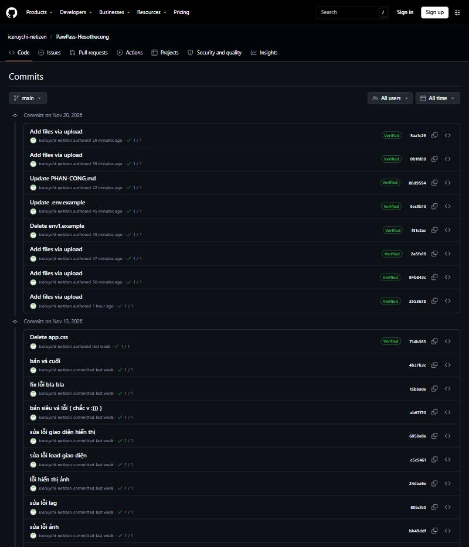 | 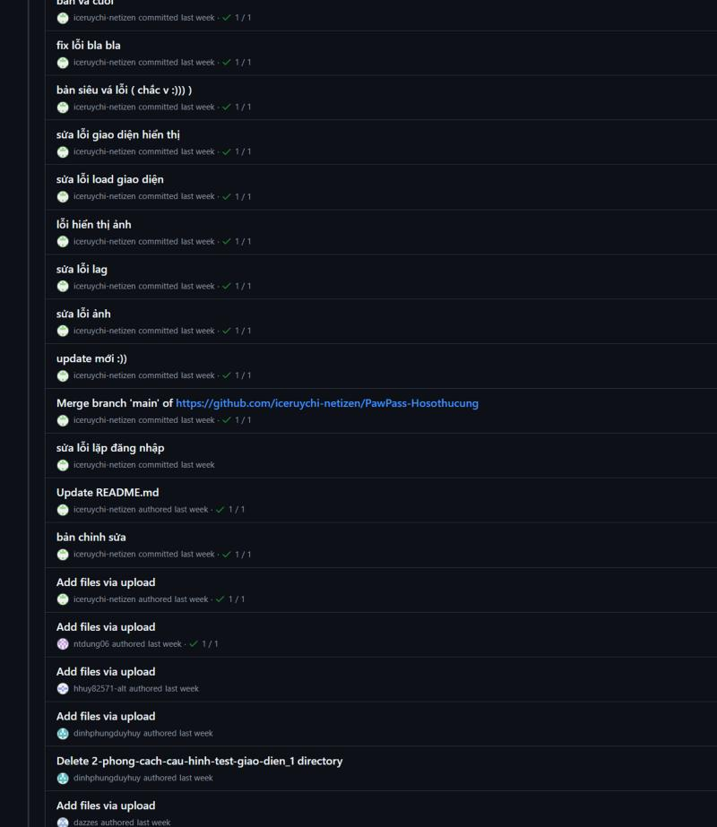 |

---

## Task 2 — Implement User Interface

### (a) Các trang đã xây dựng

Ứng dụng chính là SPA trong `public/index.html` (điều hướng bằng `#/...`, xử lý trong `public/js/app.js`). Trang Giới thiệu và Liên hệ là hai trang HTML riêng.

| Trang | URL / Route | Mô tả | Người thực hiện |
|---|---|---|---|
| Homepage (Trang chủ) | `/#/dashboard` | Lời chào, số liệu tổng, thẻ hộ chiếu từng bé, "Cần để ý", "Gần đây" | Hữu Triết, Thế Dũng |
| Đăng nhập / Đăng ký | `/` | Form đăng nhập và đăng ký, có kiểm tra dữ liệu | Hữu Triết, Thế Dũng |
| Thú cưng | `/#/pets` | Danh sách các bé, tìm và lọc theo loài, thêm / sửa / xóa | Hữu Triết, Thế Dũng |
| Chi tiết thú cưng | `/#/pets/:id/health` · `/vaccinations` · `/documents` | Hộ chiếu của bé với 3 tab: sức khỏe, tiêm phòng, tài liệu | Hữu Triết, Thế Dũng |
| Tìm kiếm | `/#/search` | Tìm trên toàn bộ dữ liệu, lọc theo loại | Hữu Triết, Thế Dũng |
| Tài khoản | `/#/account` | Sửa thông tin, ảnh đại diện, đổi mật khẩu, đăng xuất | Hữu Triết, Thế Dũng |
| **About** (Giới thiệu) | `/gioi-thieu.html` | Vấn đề, tính năng, cách dùng, nhóm thực hiện | Hữu Triết |
| **Contact** (Liên hệ) | `/lien-he.html` | Form góp ý / báo lỗi, thông tin nhóm, câu hỏi thường gặp | Hữu Triết |

| Đăng nhập | Giới thiệu | Liên hệ |
|---|---|---|
| 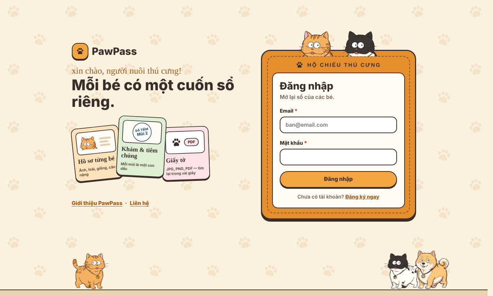 |  |  |

### (b) Sử dụng Tailwind CSS

- **Người thực hiện:** Hữu Triết (đợt bổ sung 20/11).
- **Cài đặt:** `tailwindcss` trong `devDependencies` của `package.json`; cấu hình ở [`tailwind.config.js`](tailwind.config.js); nguồn ở [`src/tailwind.css`](src/tailwind.css); lệnh `npm run build:css` sinh ra `public/css/tailwind.css` (đã nén). Vercel tự chạy lệnh này khi deploy (`buildCommand` trong `vercel.json`).
- **Phạm vi:** Tailwind dùng cho trang Giới thiệu và Liên hệ. Ứng dụng chính giữ CSS viết tay trong `public/css/app.css` vì đã làm xong từ prototype Step 1; `content` của Tailwind chỉ quét các trang mới để hai bộ CSS không đè nhau.
- **Màu và phông riêng:** khai báo trong `theme.extend` cho giống ứng dụng chính: `bg-cream`, `bg-paper`, `text-ink`, `bg-orange`, `bg-mint`, `bg-sky`, `bg-rose`, phông `font-display` (Baloo 2), `font-body` (Nunito), `font-hand` (Patrick Hand), bóng `shadow-chunky`.
- **Component tự định nghĩa** bằng `@layer components` + `@apply`: `.pp-card`, `.pp-btn`, `.pp-input`.
- **Ví dụ utility classes đã dùng:**
  - Lưới responsive: `grid gap-5 sm:grid-cols-2 lg:grid-cols-4`, `md:grid-cols-2`, `lg:grid-cols-5` + `lg:col-span-3`
  - Menu điện thoại: `hidden md:flex`, `md:hidden`, `absolute top-full md:static`
  - Trạng thái form: `focus:ring-4 focus:ring-orange/40`, `peer-checked:bg-orange` (nút chọn chủ đề), báo lỗi bằng `border-red-700` / `text-red-700`
  - Khác: `sticky top-0`, `max-w-6xl mx-auto`, `rotate-12`, `divide-y-2 divide-dashed`

### (c) Các tính năng tương tác

> Cột "Người thực hiện": người phụ trách và đưa phần đó lên repo. Mã nguồn được viết với AI (xem **Khai báo sử dụng AI**).

| Tính năng | Mô tả | File / Component | Người thực hiện |
|---|---|---|---|
| Modal thêm / sửa | Form thêm và sửa thú cưng, lần khám, mũi tiêm, tài liệu, tài khoản trong hộp thoại | `public/js/app.js` (`openModal`, `submitModal`) | Thế Dũng |
| Form validation | Kiểm tra ngay trên trình duyệt (email, mật khẩu, cân nặng, ngày không ở tương lai, loại và dung lượng tệp); cùng bộ quy tắc với máy chủ | `public/js/validators.js`, `public/js/app.js` | Duy Quang, Thế Dũng |
| Form liên hệ | Báo lỗi ngay dưới ô, đếm ký tự, gửi thành Issue trên GitHub | `public/js/site.js` | Hữu Triết |
| Accordion câu hỏi thường gặp | Bấm để mở / đóng câu trả lời, hỗ trợ bàn phím (`aria-expanded`) | `public/js/site.js` | Hữu Triết |
| Menu điện thoại | Nút ☰ mở / đóng menu, phím Esc để đóng | `public/js/site.js` | Hữu Triết |
| Tìm kiếm & lọc | Gõ là lọc ngay, không tải lại trang | `public/js/app.js` | Thế Dũng |
| Tải ảnh & tài liệu | Thu nhỏ ảnh trước khi gửi, xem trước ảnh / PDF, tải về | `public/js/app.js` (`ppShrink`, `docUrl`) | Thế Dũng, Hữu Triết (bản sửa sau deploy) |
| Màn hình chờ & hoạt cảnh | Chó mèo chạy vào nhà cho đến khi dữ liệu tải xong; thú cưng đi dạo cuối trang, bấm vào thì nhảy | `public/index.html`, `public/css/app.css`, `public/js/app.js` | Hữu Triết, Duy Huy, Thế Dũng; sửa giật và chờ tải xong: Hữu Triết |

**Cách kiểm tra:** test E2E bằng Playwright ([`tests/ui/run-ui.js`](tests/ui/run-ui.js)) tự bấm qua toàn bộ luồng: đăng ký, thêm thú cưng, nhập sai form, tải tệp, tìm kiếm, người khác mở link bị chặn, xóa, đăng xuất.

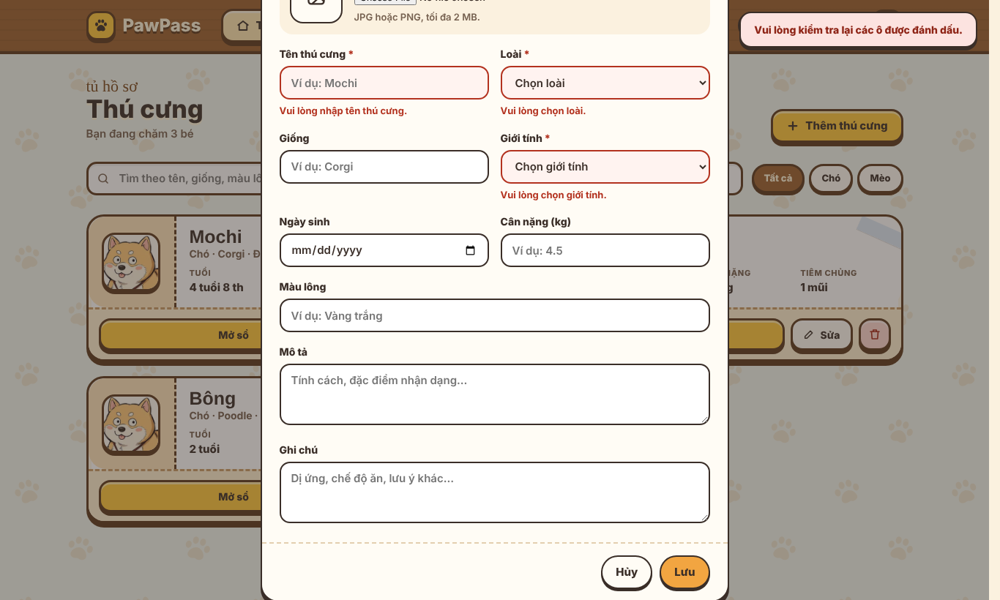

### (d) Giao diện trên nhiều thiết bị

- [x] Mobile (< 768px) — kiểm tra ở 390px
- [x] Tablet (768px – 1024px) — kiểm tra ở 820px
- [x] Desktop (> 1024px) — kiểm tra ở 1366px

Test E2E kiểm tra **không có cuộn ngang** trên mọi trang ở cả 3 khổ. Ô nhập trên điện thoại dùng chữ 16px để iPhone không tự phóng to.

| Mobile (390px) | Tablet (820px) | Desktop (1366px) |
|---|---|---|
|  |  |  |

---

## Task 3 — Database Integration & Dynamic Content

### (a) Thiết kế cơ sở dữ liệu

- **Hệ quản trị CSDL:** PostgreSQL (Neon)
- **Số bảng:** 5 — định nghĩa ở [`db/schema.sql`](db/schema.sql)

| Bảng | Mô tả | Các cột chính |
|---|---|---|
| `users` | Tài khoản người dùng | `id`, `name`, `email` (duy nhất), `password_hash`, `avatar` |
| `pets` | Thú cưng, mỗi bé thuộc một người | `id`, `user_id` → users, `name`, `species`, `gender`, `date_of_birth`, `weight`, `photo` |
| `health_records` | Các lần khám | `id`, `pet_id` → pets, `examination_date`, `reason`, `diagnosis`, `treatment`, `medication` |
| `vaccinations` | Các mũi tiêm | `id`, `pet_id` → pets, `vaccine_name`, `vaccination_date`, `dose` |
| `documents` | Giấy tờ đã tải lên | `id`, `pet_id` → pets, `file_name`, `file_type` (jpg/png/pdf), `file_path`, `description` |

Mọi khóa ngoại đều `ON DELETE CASCADE`: xóa một bé là xóa luôn hồ sơ, mũi tiêm, tài liệu của bé. Có ràng buộc `CHECK` cho loài, giới tính, cân nặng (0 < kg ≤ 200) và loại tệp.

**Xem lại lược đồ (27/11/2026):** cả nhóm xem lại 5 bảng, khóa ngoại `ON DELETE CASCADE` và các ràng buộc `CHECK` trong buổi họp duyệt; kết luận giữ nguyên lược đồ — [biên bản](docs/bien-ban/2026-11-27-hop-duyet-wireframe-va-csdl.md) (Issue [#8](https://github.com/iceruychi-netizen/PawPass-Hosothucung/issues/8), PR [#19](https://github.com/iceruychi-netizen/PawPass-Hosothucung/pull/19)).

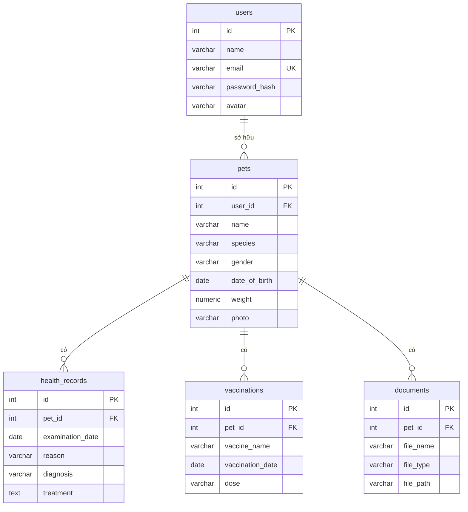

### (b) Kết nối cơ sở dữ liệu

- **Server-side:** Node.js 20 (module `http`, không dùng framework), triển khai thành Vercel Function ([`api/index.js`](api/index.js) → [`server/app.js`](server/app.js))
- **Cách kết nối:** RESTful API (JSON) — trình duyệt gọi `/api/...`, máy chủ truy vấn PostgreSQL qua thư viện `pg` với câu lệnh có tham số (`$1, $2`) để chống SQL injection ([`server/db.js`](server/db.js))
- **CRUD đã thực hiện:**
  - [x] Create — `POST /api/pets`, `/api/pets/:id/health-records`, `/vaccinations`, `/documents`, `/api/auth/register`
  - [x] Read — `GET /api/overview`, `/api/pets`, `/api/pets/:id`, các danh sách con, `/api/documents/:id/download`
  - [x] Update — `PUT /api/pets/:id`, `/api/health-records/:id`, `/api/vaccinations/:id`, `/api/auth/me`
  - [x] Delete — `DELETE /api/pets/:id`, `/api/health-records/:id`, `/api/vaccinations/:id`, `/api/documents/:id`

**Kiến trúc:**

```
Trình duyệt (HTML/CSS/JS)  ──HTTPS, JSON, token đăng nhập──▶  Vercel Function (Node.js, server/app.js)
                                                                 │  kiểm tra token + quyền sở hữu ở MỌI request
                                                                 ├──▶ PostgreSQL (Neon): 5 bảng
                                                                 └──▶ Vercel Blob: ảnh và giấy tờ
```

Mật khẩu băm bằng scrypt; token đăng nhập ký bằng HS256 (hết hạn 7 ngày); người khác mở dữ liệu không phải của mình nhận lỗi 403. Toàn bộ 27 endpoint: [`docs/KY-THUAT.md`](docs/KY-THUAT.md).

### (c) Các trang hiển thị dữ liệu động

| Trang | Dữ liệu hiển thị | Query / Endpoint | Người thực hiện |
|---|---|---|---|
| Trang chủ | Số bé, lần khám, mũi tiêm, tài liệu; thẻ từng bé; "Cần để ý"; "Gần đây" | `GET /api/overview` (4 truy vấn song song, lọc theo `pets.user_id`) | Thành Đạt, Thế Dũng; `/api/overview` thêm sau bởi Hữu Triết |
| Thú cưng | Danh sách bé của người dùng | `GET /api/pets` → `SELECT * FROM pets WHERE user_id = $1` | Thành Đạt, Thế Dũng |
| Chi tiết — Sức khỏe | Dòng thời gian các lần khám | `GET /api/pets/:id/health-records` | Thành Đạt, Thế Dũng |
| Chi tiết — Tiêm phòng | Các mũi tiêm dạng con dấu | `GET /api/pets/:id/vaccinations` | Thành Đạt, Thế Dũng |
| Chi tiết — Tài liệu | Danh sách giấy tờ, ảnh xem trước | `GET /api/pets/:id/documents`, `GET /api/documents/:id/download` | Thành Đạt, Thế Dũng |
| Tìm kiếm | Kết quả trên toàn bộ dữ liệu | Dữ liệu từ `GET /api/overview`, lọc trên trình duyệt | Thế Dũng |
| Tài khoản | Tên, email, ảnh đại diện | `GET /api/auth/me` | Thành Đạt, Thế Dũng |

| Trang chủ | Thú cưng | Tài khoản |
|---|---|---|
|  |  | 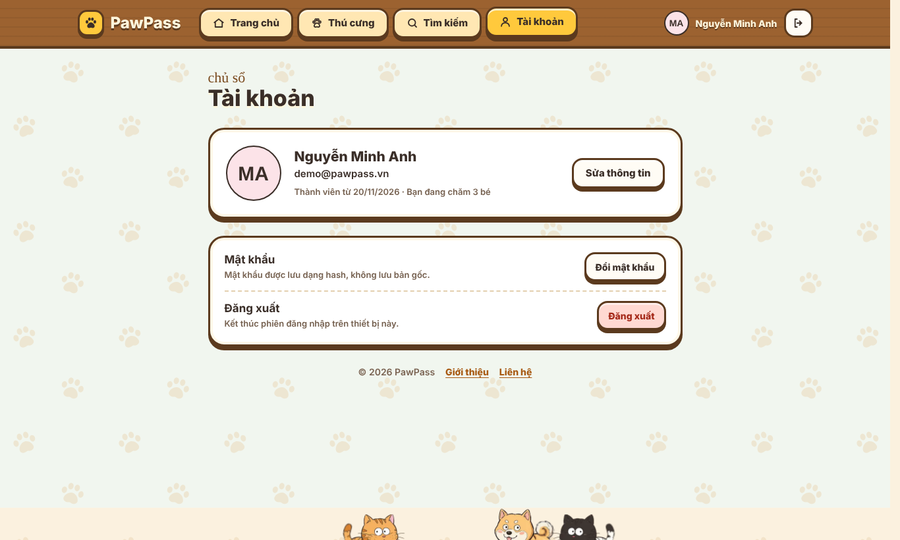 |

---

## Task 4 — Optimization

### (a) Lighthouse

**Kết quả trước khi tối ưu** (13/11/2026)

Nhóm không lưu lại ảnh điểm số của lần đo đầu tiên; điểm còn nhớ được là Accessibility **98** (thiếu thẻ `<main>`). Dưới đây là ảnh các mục Lighthouse báo cần sửa ở các lần đo trong ngày 13/11:

| Metric | Score |
|---|---|
| Performance | *(không lưu ảnh)* |
| Accessibility | 98 |
| Best Practices | *(không lưu ảnh)* |
| SEO | *(không lưu ảnh)* |

| Các mục cần sửa (13/11) | Mục còn lại sau lần sửa đầu (13/11) |
|---|---|
| 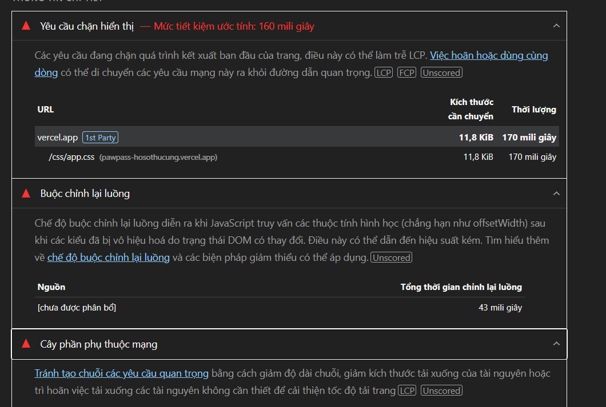 | 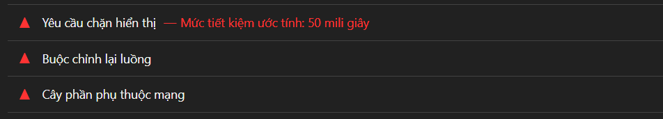 |

**Các vấn đề phát hiện và cách khắc phục:**

| Vấn đề | Hành động khắc phục |
|---|---|
| Ảnh minh họa nặng (PNG, tổng 1.040 KB) | Chuyển sang WebP, thu nhỏ đúng kích thước hiển thị → 196 KB |
| Thiếu điểm mốc `<main>` cho trình đọc màn hình | Bọc nội dung bằng `<main id="app">` |
| Phông chữ Google chặn hiển thị | Tải bằng `rel="preload"` rồi đổi thành stylesheet khi tải xong |
| Script chặn hiển thị | Thêm `defer` cho mọi script |
| `app.css` chặn hiển thị ("Yêu cầu chặn hiển thị") | Tải song song, giữ màu nền trong lúc chờ, hiện giao diện khi CSS về |
| Màn hình giật (hoạt cảnh dùng `left`, 182 lần tính bố cục / 3 giây) | Đổi sang `transform` → còn 2 lần |
| Trang chủ gọi máy chủ 1 + 3×số bé lần | Thêm `GET /api/overview`: 1 lần gọi |
| Ảnh tải lên lớn (ảnh điện thoại 2 MB) | Thu nhỏ còn tối đa 800px trước khi gửi (~230 KB) |
| Google Analytics và Sentry làm chậm lúc mở trang | Chỉ tải sau khi trang hiện xong và trình duyệt rảnh |

**Kết quả sau khi tối ưu** — PageSpeed Insights trên web thật, ngày 20/11/2026 (trang đầu, chưa đăng nhập)

| Metric | Desktop | Mobile |
|---|---|---|
| Performance | 100 | 100 |
| Accessibility | 100 | 100 |
| Best Practices | 100 | 100 |
| SEO | 100 | 100 |

| Desktop | Mobile |
|---|---|
| 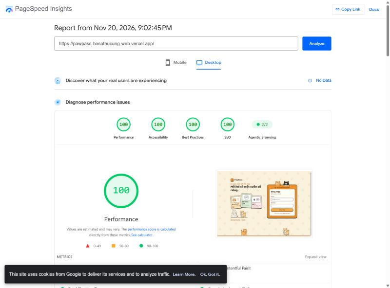 | 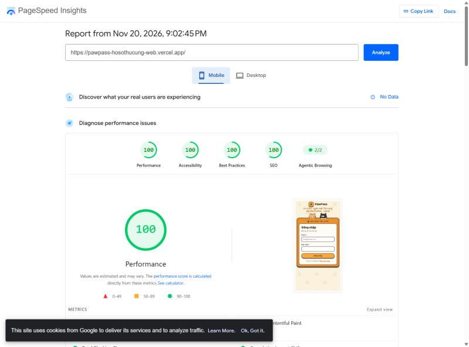 |

**Đo các trang chính sau khi đăng nhập** (25–26/11/2026)

Bản chấm thử ghi nhận nhóm mới đo trang đầu (màn đăng nhập), nên nhóm đo thêm các trang chính **sau khi đăng nhập** bằng Lighthouse trong Chrome DevTools: chế độ Navigation, **bỏ chọn "Clear storage"** để giữ phiên đăng nhập, đo cả Desktop và Mobile trên web thật.

| Trang | Desktop (Perf / A11y / BP / SEO) | Mobile (Perf / A11y / BP / SEO) |
|---|---|---|
| Tổng quan `#/dashboard` | 83–87 / 100 / 100 / 100 → **100 / 100 / 100 / 100** sau khi sửa | 99 / 100 / 100 / 100 |
| Danh sách thú cưng `#/pets` | 100 / 100 / 100 / 100 | 99 / 100 / 100 / 100 |
| Chi tiết một bé `#/pets/7/health` | 100 / 99 / 100 / 100 → **A11y 100** sau khi sửa | 99 / 99 / 100 / 100 |
| Tìm kiếm `#/search` | 100 / 100 / 100 / 100 | 99 / 100 / 100 / 100 |

Điểm Performance 99 và 100 dao động giữa các lần đo; 2 trang có mục dưới 100 thật sự được sửa như sau, mỗi lỗi một Issue → nhánh riêng → Pull Request:

| Trang | Lighthouse báo | Nguyên nhân | Cách sửa | Kết quả |
|---|---|---|---|---|
| Tổng quan (Desktop) | Performance 83–87, **CLS 0,262**, LCP 1,3 s | Phông Baloo 2, Nunito tải từ Google Fonts **sau** khi chữ đã hiện → chữ đổi cỡ, cả trang xô lệch | Đổi `display=swap` → `display=optional` trong link phông của 3 trang (Issue [#1](https://github.com/iceruychi-netizen/PawPass-Hosothucung/issues/1), PR [#2](https://github.com/iceruychi-netizen/PawPass-Hosothucung/pull/2)) | Performance **100**, CLS **0**, LCP **0,2 s** |
| Chi tiết một bé | Accessibility 99, *heading-order* | Tên lần khám / mũi tiêm dùng `<h3>` ngay sau `<h1>` (tên bé), bỏ qua cấp `<h2>` | Đổi 7 thẻ `<h3>` thành `<h2>`, giữ nguyên class nên giao diện không đổi (Issue [#3](https://github.com/iceruychi-netizen/PawPass-Hosothucung/issues/3), PR [#4](https://github.com/iceruychi-netizen/PawPass-Hosothucung/pull/4)) | Accessibility **100** (đo trên link Preview của PR) |

Ghi chú: khi đo trên link **Preview** của Vercel, SEO chỉ còn 63 vì Vercel tự gắn `x-robots-tag: noindex` cho bản xem thử; web chính không bị.

| Tổng quan — Desktop, trước khi sửa | Tổng quan — Desktop, sau khi sửa |
|---|---|
| 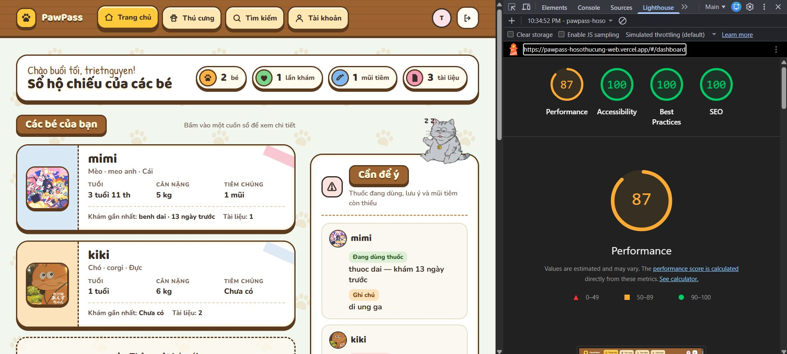 | 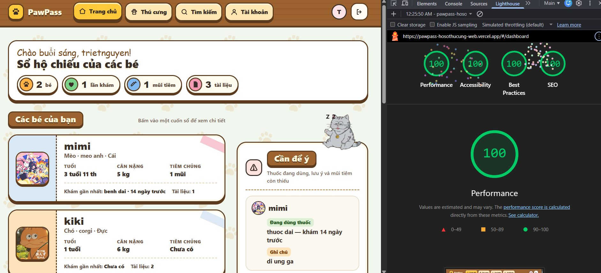 |

| Chi tiết một bé — Desktop, trước khi sửa | Chi tiết một bé — Desktop, sau khi sửa (Preview PR #4) |
|---|---|
| 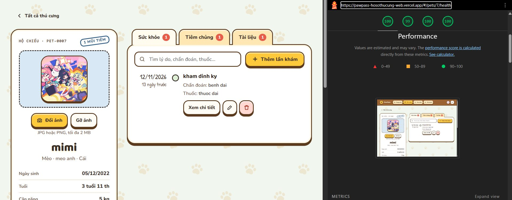 | 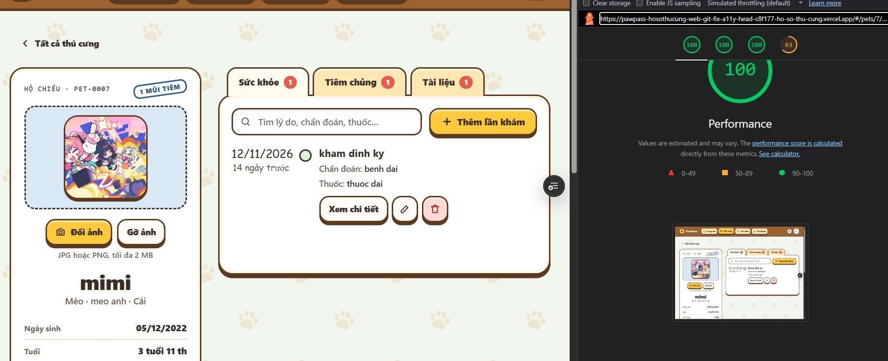 |

| Tổng quan — Mobile | Chi tiết một bé — Mobile (trước khi sửa) |
|---|---|
| 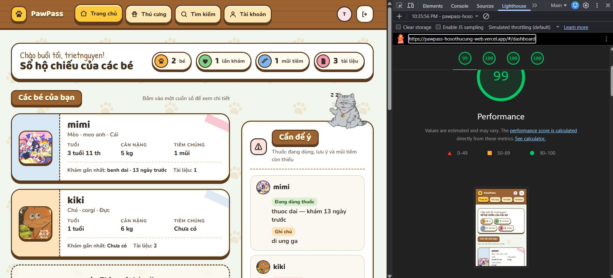 | 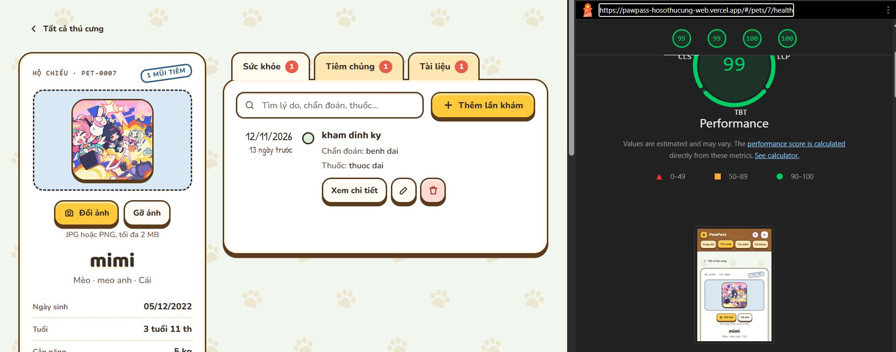 |

| Danh sách thú cưng — Desktop | Danh sách thú cưng — Mobile |
|---|---|
| 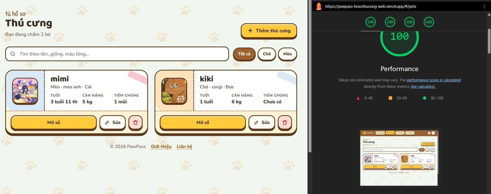 | 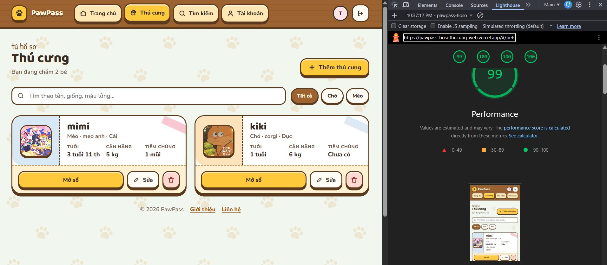 |

| Tìm kiếm — Desktop | Tìm kiếm — Mobile |
|---|---|
| 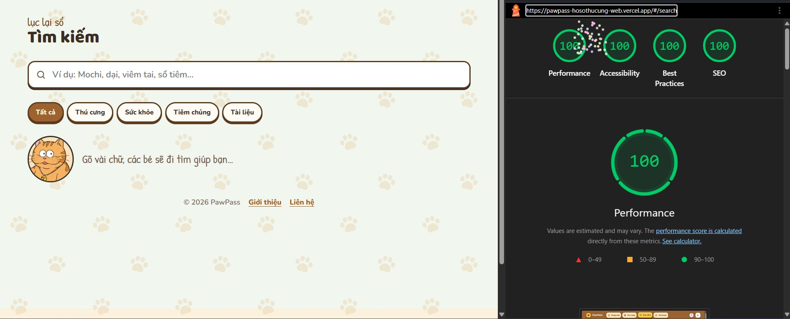 | 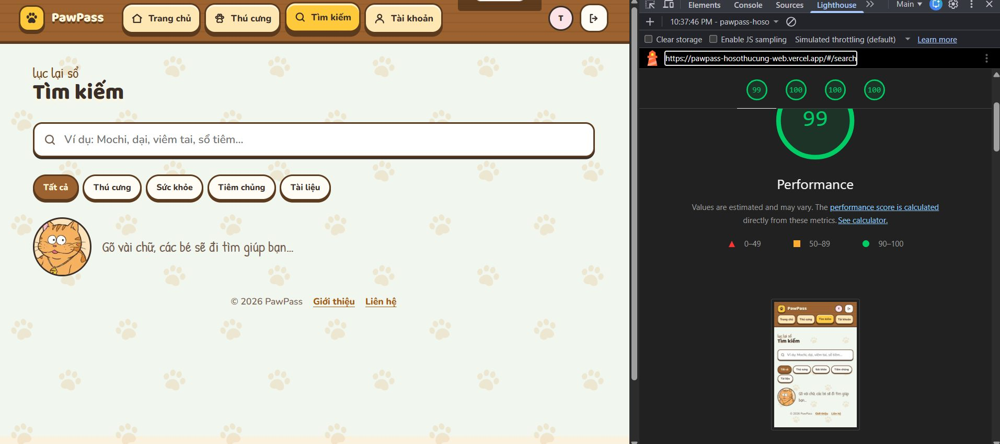 |

### (b) Theo dõi lỗi và hành vi người dùng

Cả hai đều bật bằng **biến môi trường trên Vercel** (Settings → Environment Variables), không ghi cứng mã vào code. Trình duyệt lấy cấu hình qua `GET /api/config`.

#### Google Analytics

- [x] Đã tích hợp (Hữu Triết, đợt bổ sung 20/11) — [`public/js/monitoring.js`](public/js/monitoring.js)
- **Measurement ID:** `G-JJL147Q4LV` (property **PawPass**, luồng **PawPass web**), đặt trong biến `GA_MEASUREMENT_ID` trên Vercel từ 20/11/2026
- Đã tắt *"thay đổi trang dựa trên sự kiện nhật ký duyệt web"* trong Tính năng đo lường nâng cao, vì code đã tự gửi `page_view` khi đổi trang (tránh đếm trùng)
- **Cách tích hợp:** tải `gtag.js` sau khi trang hiện xong; vì ứng dụng là SPA nên tự gửi `page_view` mỗi khi đổi trang (số id trong đường dẫn được thay bằng `:id`, ví dụ `/#/pets/:id/health`). Sự kiện riêng: `login`, `sign_up`, `create_pet`, `create_health`, `create_vacc`, `create_doc`, `update_*`, `form_invalid`, `contact_submit`, `faq_open`. Không gửi tên, email hay nội dung hồ sơ.

**Kiểm tra:** ngày 20/11/2026, sau khi đặt mã trên Vercel, Google Analytics ghi nhận **2 người dùng đang hoạt động** (Việt Nam) trong báo cáo thời gian thực.

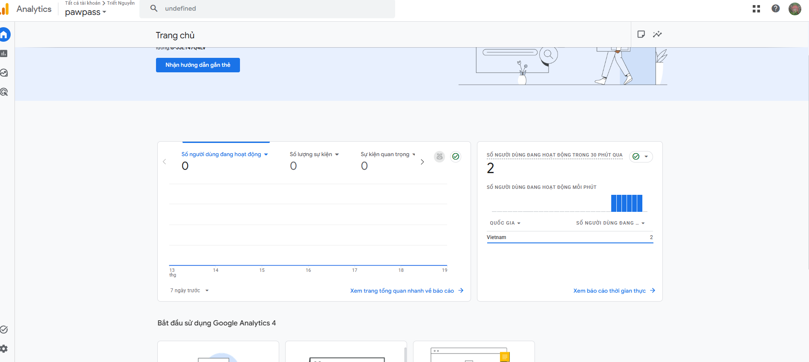

#### Sentry

- [x] Đã tích hợp
- **Công cụ:** Sentry
- **DSN / Config:** project Sentry **javascript** (nền tảng Browser JavaScript, chỉ bật Error monitoring), DSN đặt trong biến `SENTRY_DSN` trên Vercel từ 20/11/2026; trình duyệt nhận DSN qua `GET /api/config`
- **Các loại lỗi được theo dõi:**
  - **Trình duyệt** ([`public/js/monitoring.js`](public/js/monitoring.js)): lỗi JavaScript và Promise bị từ chối, kể cả lỗi xảy ra trước khi Sentry kịp tải
  - **Máy chủ** ([`server/monitor.js`](server/monitor.js)): mọi lỗi 5xx của API (mất kết nối database, lỗi lưu tệp lên Blob, lỗi không lường trước), kèm phương thức, đường dẫn đã ẩn id và stack trace. Lỗi do người dùng nhập sai (4xx) không gửi. Có unit test với máy chủ Sentry giả ([`tests/unit/monitor.test.js`](tests/unit/monitor.test.js))

**Kiểm tra:** ngày 20/11/2026 nhóm gửi một lỗi thử từ trang Giới thiệu trên web thật; Sentry nhận được (`JAVASCRIPT-2`, ảnh dưới). `JAVASCRIPT-1` là lỗi mẫu Sentry tự tạo khi lập project.

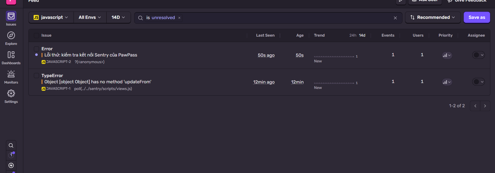

---

## Task 5 — UI/UX Peer Review & Evaluation

### (a) Feedback cho các nhóm khác

Người review: Nguyễn Hữu Triết (đợt đầu); góp ý chi tiết bổ sung ngày 26–27/11: Nguyễn Thế Dũng (nhóm 2), Nguyễn Hữu Triết (nhóm 5).

#### Nhóm được review #1

- **Tên nhóm / dự án:** Nhóm 2 — Focus Space
- **Link project:** https://focuspace-iota.vercel.app/
- **Cách review:** dùng thử web, thử tương tác với chú mèo và các vật thể trong phòng, rồi góp ý trực tiếp với nhóm.

| Khía cạnh | Điểm mạnh | Gợi ý cải thiện |
|---|---|---|
| Usability | Trang đầu nói rõ web dùng để làm gì, nút **Vào phòng** nổi bật nên bắt đầu rất nhanh | Xem lại số lượng vật thể trong phòng cho vừa phải, để người dùng dễ tập trung và dễ thao tác |
| Aesthetics | Phong cách pixel art ấm áp, tông màu tối dịu mắt, hợp không khí học tập kiểu lo-fi | — |
| User-Friendliness | Cho tự chọn phòng (học, ngủ, sân vườn), âm thanh, thời tiết và đồ vật, có gợi ý đeo tai nghe | Tương tác với chú mèo nên sống động hơn (phản hồi rõ hơn khi người dùng bấm hoặc rê chuột vào) |

**Góp ý chi tiết (26/11/2026):** [`docs/reviews/given/nhom-2-focuspace.md`](docs/reviews/given/nhom-2-focuspace.md) — 3 tiêu chí, mỗi ý chỉ rõ trang và chi tiết, bảng tổng hợp 7 đề xuất kèm mức độ; đã gửi cho nhóm 2 (Issue [#9](https://github.com/iceruychi-netizen/PawPass-Hosothucung/issues/9), PR [#13](https://github.com/iceruychi-netizen/PawPass-Hosothucung/pull/13), ảnh minh họa và ảnh tin nhắn trong PR).

#### Nhóm được review #2

- **Tên nhóm / dự án:** Nhóm 5 — Web bán quần áo
- **Link project:** https://thai-tu-fashion-v1.vercel.app (đợt đầu nhóm 5 chưa đưa web lên mạng, nhóm góp ý trên bản nhóm 5 đang làm)

| Khía cạnh | Điểm mạnh | Gợi ý cải thiện |
|---|---|---|
| Usability | — | Trình bày lại bố cục cho dễ theo dõi, dễ tìm sản phẩm |
| Aesthetics | — | Góp ý về giao diện và thiết kế tổng thể cho hài hòa, hợp mắt hơn |
| User-Friendliness | Có cơ chế **phối đồ và đề xuất quần áo**, giúp người dùng chọn trang phục dễ hơn | — |

**Góp ý chi tiết (27/11/2026):** [`docs/reviews/given/nhom-5-thai-tu-fashion.md`](docs/reviews/given/nhom-5-thai-tu-fashion.md) — dùng thử bản Thai Tu Fashion trên mạng, góp ý theo 3 tiêu chí, bảng tổng hợp 5 đề xuất kèm mức độ và 5 ảnh minh họa; đã gửi cho nhóm 5 (Issue [#10](https://github.com/iceruychi-netizen/PawPass-Hosothucung/issues/10), PR [#18](https://github.com/iceruychi-netizen/PawPass-Hosothucung/pull/18), [#20](https://github.com/iceruychi-netizen/PawPass-Hosothucung/pull/20)).

### (b) Xử lý feedback nhận được

| Feedback | Nguồn (nhóm nào) | Quyết định | Lý do / Commit |
|---|---|---|---|
| Sau màn hình chờ, trang chính vẫn phải đợi một lúc mới hiện thông tin | Nhóm 2 | Đã implement | Cho trang chính tải dữ liệu và ảnh **ở nền, bên dưới màn hình chờ**; màn hình chờ chỉ tắt khi đã tải xong, nên người dùng không phải đợi thêm — [`c5c5461`](https://github.com/iceruychi-netizen/PawPass-Hosothucung/commit/c5c5461), [`6058e8a`](https://github.com/iceruychi-netizen/PawPass-Hosothucung/commit/6058e8a) |
| Bấm F5 ở một trang thì giao diện bị giật: nhảy qua trang đăng ký / đăng nhập rồi mới về trang đang xem | Nhóm 2 | Đã implement | Ghi nhớ trang người dùng đang ở và phiên đăng nhập, F5 mở lại đúng trang đó ngay — [`9725d89`](https://github.com/iceruychi-netizen/PawPass-Hosothucung/commit/9725d89) |
| Chú mèo quá to, ảnh lớn khi chuyển động làm giảm điểm Lighthouse | Nhóm 2 | Không implement | Chú mèo là **linh vật** của PawPass, được nhóm tổng hợp từ nhiều bản thiết kế để tạo cảm giác gần gũi với người dùng, nên nhóm giữ nguyên kích thước. Nhóm giảm ảnh hưởng tới tốc độ theo cách khác: ảnh WebP, chuyển động bằng `transform` (Lighthouse hiện đạt 100 ở cả 4 mục) |

**Trước / sau khi sửa góp ý về màn hình chờ:**

| Trước (13/11): hết màn hình chờ, trang chủ vẫn còn "Đang gọi các bé về…" | Sau: hết màn hình chờ là trang chủ đã có đủ thông tin |
|---|---|
| 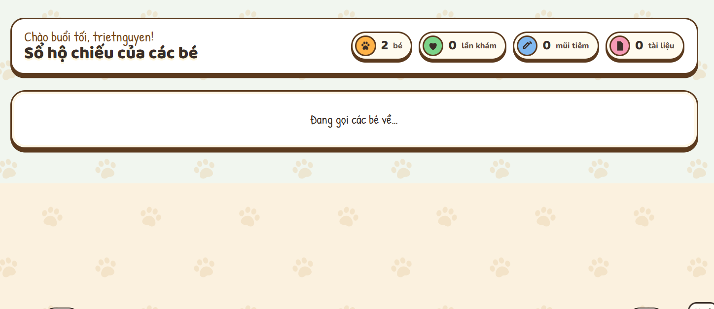 |  |

---

## Deliverables Checklist

- [x] Source code trên GitHub (repository public)
- [x] README.md đầy đủ: hướng dẫn cài đặt, tổng quan, tính năng kèm ảnh, ERD
- [x] Video demo trên YouTube (tối đa 10 phút, tối thiểu 720p, không để riêng tư)
- [x] Self-report: đủ 5 file trong `docs/self-reports/`

---

## Self-Reports

| Họ tên | MSSV | Link Self-Report |
|---|---|---|
| Nguyễn Hữu Triết | 24090003 | [self-report-24090003.md](docs/self-reports/self-report-24090003.md) |
| Đinh Phùng Duy Huy | 24090016 | [self-report-24090016.md](docs/self-reports/self-report-24090016.md) |
| Nguyễn Thế Dũng | 24090007 | [self-report-24090007.md](docs/self-reports/self-report-24090007.md) |
| Nguyễn Phước Thành Đạt | 24090026 | [self-report-24090026.md](docs/self-reports/self-report-24090026.md) |
| Đào Duy Quang | 24090005 | [self-report-24090005.md](docs/self-reports/self-report-24090005.md) |

---

## Khai báo sử dụng AI

Nhóm dùng **Claude (Anthropic)** làm AI Coding Agent theo quy trình Step 3: AI nhận tài liệu Step 1–2 cùng quy tắc trong [`CLAUDE.md`](CLAUDE.md), lập kế hoạch ([`PLAN.md`](PLAN.md)), viết code và test; Hữu Triết làm việc trực tiếp với AI, deploy, thử trên web thật và báo lỗi để sửa; mỗi thành viên đưa phần mình phụ trách lên repo và đọc hiểu phần đó. Phần lớn mã nguồn được viết với sự hỗ trợ của AI. Mỗi thành viên khai báo cụ thể phần mình dùng AI trong self-report và chịu trách nhiệm giải thích được phần mình phụ trách.
