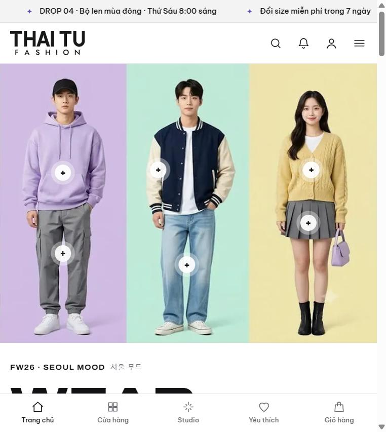
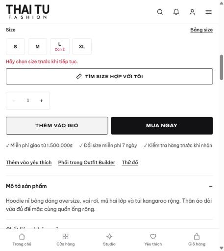
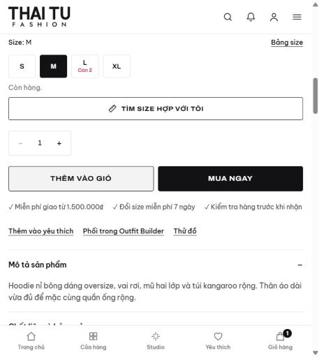
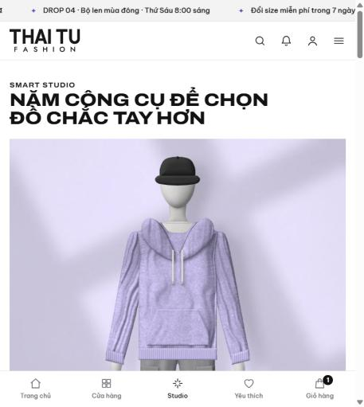

# Góp ý UI/UX cho Nhóm 5 (Thai Tu Fashion)

## Thông tin chung

- **Nhóm được review:** Nhóm 5 (Thai Tu Fashion)
- **Link web:** https://thai-tu-fashion-v1.vercel.app
- **Link repo:** https://github.com/huynhsy986-droid/thai_tu_fashion
- **Ngày review:** 27/11/2026
- **Người review:** Nguyễn Hữu Triết (Nhóm 4 – PawPass)
- **Cách review:** dùng thử trên Chrome (cửa sổ hẹp, bố cục điện thoại), đi qua Trang chủ, trang sản phẩm Hoodie oversize Cloud, thêm vào giỏ, Smart Studio.

## 1. Usability (Tính khả dụng)

**Điểm mạnh**

- Thanh điều hướng dưới cùng có 5 mục kèm cả biểu tượng lẫn chữ (Trang chủ, Cửa hàng, Studio, Yêu thích, Giỏ hàng), dễ bấm bằng ngón cái.
- Các nút trên đầu trang (Tìm kiếm, Thông báo, Đăng nhập, Menu) có vùng bấm 44×44px và nhãn cho trình đọc màn hình; bấm logo là về trang chủ.
- Trang sản phẩm bấm "Thêm vào giỏ" khi chưa chọn size thì báo đỏ "Hãy chọn size trước khi tiếp tục."; size sắp hết có ghi "Còn 2".

**Đề xuất cải thiện**

- **Thêm vào giỏ chưa có thông báo rõ:** sau khi chọn size M và bấm "Thêm vào giỏ", nhóm chỉ thấy số 1 nhỏ hiện trên biểu tượng Giỏ hàng ở thanh dưới. Đề xuất hiện thông báo ngắn "Đã thêm vào giỏ" kèm nút "Xem giỏ".
- **Nút "+" trên ảnh trang chủ chưa có gợi ý:** bấm vào là mở thẳng trang sản phẩm, nhưng trước khi bấm người dùng không biết nút để làm gì. Đề xuất thêm nhãn nhỏ (tên sản phẩm, giá) khi rê chuột / chạm lần đầu.

## 2. Aesthetics (Tính thẩm mỹ)

**Điểm mạnh**

- Ảnh bìa trang chủ 3 khung màu pastel (tím, xanh bạc hà, vàng) hợp chủ đề "Seoul mood"; chữ đen trắng, phông chữ đậm, gọn gàng.
- Trang sản phẩm trình bày rõ: dáng, chất liệu, hợp dịp, phong cách; nút "Mua ngay" nền đen nổi hơn nút "Thêm vào giỏ".

**Đề xuất cải thiện**

- **Lúc mở web hiện khung xám khá lâu:** lần đầu mở trang chủ, nhóm thấy toàn khung xám (skeleton) khoảng 5 giây rồi mới hiện ảnh. Đề xuất nén / giảm cỡ ảnh bìa và tải trước ảnh đầu tiên.
- **Ảnh trang chủ và ảnh trang sản phẩm khác kiểu:** trang chủ dùng ảnh người mẫu, trang sản phẩm dùng ảnh dựng 3D. Đề xuất có thêm ảnh người mẫu trong trang sản phẩm để đồng nhất.

## 3. User-friendliness (Tính thân thiện với người dùng)

**Điểm mạnh**

- Smart Studio gom 5 công cụ (Outfit Builder, Size Advisor, AI Stylist, Visual Search, Virtual Try-On), mỗi công cụ có 1 dòng giải thích dễ hiểu.
- Trang sản phẩm có sẵn "Tìm size hợp với tôi", "Phối trong Outfit Builder" và gợi ý "Hoàn thiện set đồ" với các món đi kèm.
- Ghi rõ chính sách ngay dưới nút mua: miễn phí giao từ 1.500.000₫, đổi size 7 ngày, kiểm tra hàng trước khi nhận.

**Đề xuất cải thiện**

- **Thông báo "Hãy chọn size" nhỏ:** dòng chữ đỏ nằm dưới hàng size, chữ nhỏ, dễ bỏ qua. Đề xuất viền đỏ hàng nút size hoặc rung nhẹ để người dùng thấy ngay.

## Bảng tổng hợp đề xuất

| # | Tiêu chí | Vấn đề | Đề xuất | Mức độ |
|---|---|---|---|---|
| 1 | Aesthetics | Mở trang chủ hiện khung xám khoảng 5 giây | Nén ảnh bìa, tải trước ảnh đầu | Trung bình |
| 2 | Usability | Thêm vào giỏ chỉ đổi số trên biểu tượng giỏ | Thông báo "Đã thêm vào giỏ" + nút "Xem giỏ" | Trung bình |
| 3 | Usability | Nút "+" trên ảnh trang chủ chưa có gợi ý | Nhãn tên / giá sản phẩm | Thấp |
| 4 | User-friendliness | Thông báo "Hãy chọn size" nhỏ, dễ bỏ qua | Viền đỏ hàng size | Thấp |
| 5 | Aesthetics | Ảnh trang chủ (người mẫu) khác ảnh sản phẩm (3D) | Thêm ảnh người mẫu ở trang sản phẩm | Thấp |

## Hình minh họa

| Ảnh | Minh họa cho |
|---|---|
|  | Đề xuất #1: khung xám khi mới mở |
|  | Điểm mạnh: ảnh bìa pastel; Đề xuất #3: nút "+" |
|  | Điểm mạnh: báo lỗi khi chưa chọn size; Đề xuất #4 |
|  | Đề xuất #2: chỉ có số 1 trên biểu tượng giỏ |
|  | Điểm mạnh: Smart Studio 5 công cụ |
